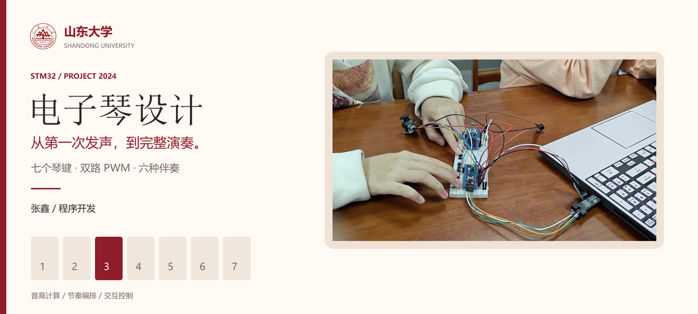
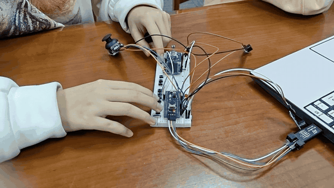
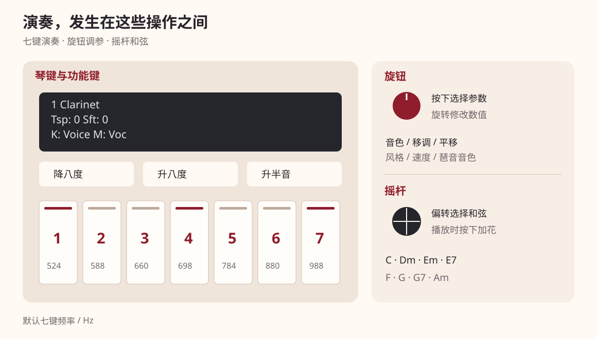
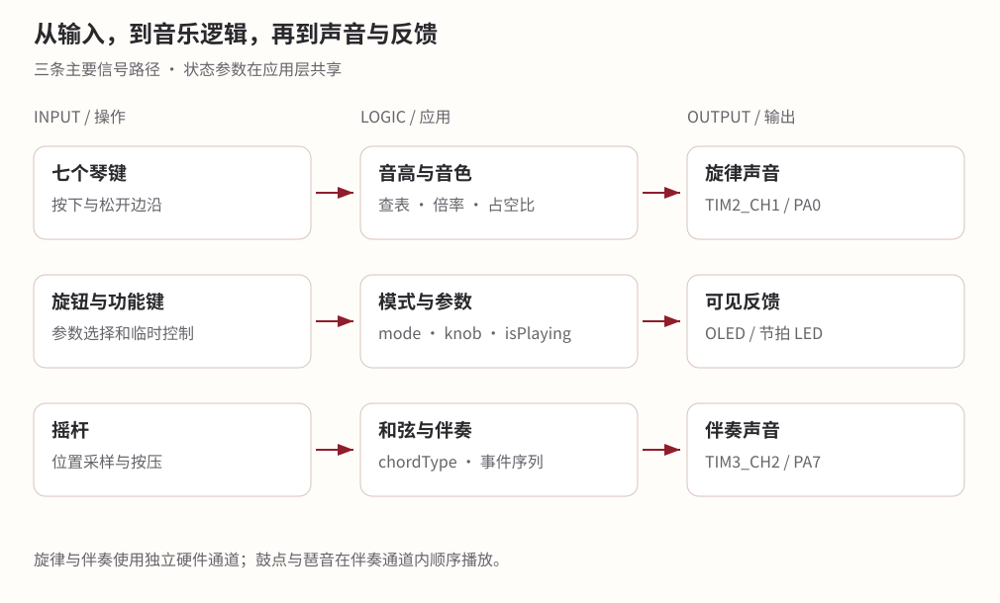

<p align="center">
  
</p>

<p align="center">
  <a href="#demo"><strong>观看演奏</strong></a> ·
  <a href="电子琴设计_技术文档.md"><strong>技术文档</strong></a> ·
  <a href="电子琴设计_技术文档.html"><strong>网页阅读版</strong></a> ·
  <a href="firmware/User/main.c"><strong>程序源码</strong></a> ·
  <a href="#build"><strong>构建与运行</strong></a>
</p>

<p align="center"></p>

七个琴键弹旋律，旋钮调整音色和音域，摇杆选择伴奏和弦。这是我在 2024 年参与的 STM32 电子琴项目，我负责主要程序开发，把声音生成、节奏编排和操作控制接进同一个系统。

<a id="demo"></a>
## 先听一段

[](assets/video/demo-short.mp4)

**[15 秒演奏片段 ↗](assets/video/demo-short.mp4)** &nbsp; · &nbsp; **[完整演示 · 2 分 19 秒 ↗](assets/video/demo-full.mp4)**

## 从七个琴键，做到旋律与伴奏


程序里，音高来自音阶表和几个独立参数。换一个调、移一段音域、临时升高八度，都可以在同一条频率计算中完成。两路定时器分别承担旋律和伴奏，琴键通过中断换音，主程序继续组织节奏。

伴奏的六种风格共用一个播放函数，各自提供琶音、鼓点和加花数组。内容写进数据，规则留在函数里，速度、和弦和灯光就能一起跟着播放流程变化。

| 演奏 | 伴奏 | 交互 |
|:---|:---|:---|
| 七键演奏与音域平移 | 8Beat、16Beat、Slow Rock | 旋钮选择并调整参数 |
| 五种占空比音色与鼓组 | Swing、March、Waltz | 摇杆选择八种和弦 |
| 移调、临时八度和半音 | 前奏、主段、加花与尾声 | OLED 显示、LED 节拍指示 |



## 读懂这份代码

技术文档沿一次琴键按下展开，讲清音符怎样产生，再把伴奏、操作和调试接进来。完整的变量、参数和外设配置放在附录中，随时可以回查。

| 从哪里开始 | 会读到什么 |
|---|---|
| [我的工作与调试经历](电子琴设计_技术文档.md) | 程序如何划分，遇到问题时怎样逐层定位，以及如何使用 AI 辅助分析 |
| [第一个琴键为什么是 524 Hz](电子琴设计_技术文档.md#chapter-3) | 从 EXTI 到音高公式，再到定时器 PSC 与 CCR |
| [一段伴奏怎样写进数组](电子琴设计_技术文档.md#chapter-6) | 六种风格、事件序列、和弦与时间分配 |
| [旋钮和摇杆怎样复用](电子琴设计_技术文档.md#chapter-7) | 模式切换、参数选择、ADC 方向判断和显示 |
| [变量与配置速查](电子琴设计_技术文档.md#appendix) | 含义、取值理由、调整效果和源码位置 |

<details>
<summary><strong>展开系统架构</strong></summary>



</details>

<a id="build"></a>
## 构建与运行

1. 使用支持 **ARM Compiler 5** 的 Keil MDK，安装 STM32F1 器件支持包。
2. 打开 [`firmware/Project.uvprojx`](firmware/Project.uvprojx)，目标器件为 **STM32F103C8**；工程工具链为 ARMCC 5.06 update 5。
3. 按[引脚与接线](电子琴设计_技术文档.md#chapter-2)连接外设，确认供电、地线与 SWD 接口。
4. Rebuild 后，通过 ST-LINK/SWD 下载；从单键、音色和音域开始，再检查伴奏与交互。

[查看完整构建步骤 →](电子琴设计_技术文档.md#chapter-10)

<details>
<summary><strong>工程目录</strong></summary>

```text
firmware/
  User/          主程序、音乐逻辑与中断
  Hardware/      琴键、声音、OLED、编码器和摇杆
  System/        PWM 与延时
  Start/         启动、CMSIS 与系统时钟
  Library/       ST 标准外设库
assets/          图表、照片、演示与样式
code/            带行号的源码阅读页
tools/           文档和图表生成工具
```

[文档维护](tools/README.md)

</details>

---

**团队** &nbsp; 张鑫 · 程序开发　雷涯棋 · 硬件操作　雷伊涵 · 报告整理

[Apache-2.0](LICENSE)
