# 电子琴设计_技术文档

## 我的主要工作与工程能力

做这台电子琴时，我希望它能够支持一段完整的演奏：用琴键弹出旋律，选一段伴奏，再一边演奏一边调整音色和和弦。整台电子琴搭在面包板上，七个琴键之外，还有旋钮、摇杆、OLED 和三颗节拍灯。我主要负责**程序开发**，需要把这些部件接入同一套操作逻辑。对演奏者来说，按键、声音和屏幕应当是连贯的；落实到程序中，则要分别处理输入电平、状态切换、频率计算和外设配置。我的工作就是把这些环节逐一接通，让各个功能共同组成能够实际演奏的系统。

<!-- ABILITY_START -->

我把发声部分分成了几层：**定时器**持续输出波形，**蜂鸣器接口**接收频率、占空比和时长，**音乐函数**负责安排音符。写旋律或伴奏时，就可以直接围绕音高和节奏组织代码。七个琴键的音域也按这个思路扩展：`scale` 保存基础音阶，`transpose` 保存移调倍率，平移、八度和半音各有自己的参数。几个变量组合起来，同一个琴键就能发出不同的音。

伴奏沿用同一套播放流程。六种风格各自提供琶音、鼓点和加花数组，共用一个 `acmpPlay()`；切换风格时更换序列，速度、和弦与灯光的处理规则继续复用。为了让它们配合起来，我需要算清一次事件占用多少时间、剩余时间怎样分配，以及哪个状态决定接下来播放什么。调整节奏时修改数组，调整播放规则时修改公共函数。

交互又带来了新的要求。一个旋钮要调整多组参数，屏幕下方的按键在设置和演奏时也有不同用途。我用 `mode`、`knob` 和 `isPlaying` 区分这些场景，让操作含义跟着当前状态变化。琴键通过中断更新旋律，主程序组织伴奏，两路定时器分别输出声音。要把这套流程写通，就需要同时考虑模块之间的调用关系、变量的读写位置和操作发生的时机。

调试时，这些联系也成了排查问题的线索。项目里既有节拍与灯光的配合，也有 Keil 工程设置和元件接线的调整。构建没完成，就先看报错和配置；输入没有反应，就查引脚、电平和中断；声音或节奏不符合预期，再回到变量、公式和等待时间。先分清问题发生在哪一层，下一步的检查才有方向。

在使用 coding agent 之前，我主要按下面三个步骤开展 **Debug**。

1. **理解整体框架。** 动手前，我会根据目标拆分子任务，把各部分的职责、输入输出、调用关系和关键参数写进技术文档。例如，琴键负责触发音符，音高计算给出频率，声音驱动把参数送到定时器；先把这条路径理顺，再分别实现。后续遇到逻辑不通或思路中断，就回到文档检查遗漏的条件，并把新的理解补进去，让文档能够跟着实现一起更新。

2. **检查基本配置。** 出现问题后，我会先核查地址、路径和接口是否对应。在这个项目中，就是逐项对照接线与 GPIO 配置、外设通道与调用参数，以及 Keil 中的目标器件、头文件路径和源文件列表；同时沿着数据流看一遍，确认输入从哪里来、结果传给谁。

3. **分而治之，逐步验证。** 对于逻辑或计算问题，我会先重复触发问题的操作，再根据 IDE 的报错、运行结果和变量状态，找到最早偏离预期的位置。每次只改一处相关内容，用相同条件重新运行，观察结果怎样变化。代码较多时，就按模块逐个检查；各模块能够独立工作后，再核对它们之间的调用顺序、参数传递和共享状态。最后回到完整演奏中，把琴键、音色、伴奏和模式切换连起来检查，确认局部修改能够融入整体流程。

## 阅读导航

整台琴的实现可以从一个音符讲起。声音有了，再扩展音域和伴奏；功能多起来以后，才会看清交互与调度为什么要这样安排。参数和配置的完整解释放在附录，读到需要时可以随时查阅。

1. [从一台能够演奏的电子琴说起](#chapter-1)
2. [先把硬件连接起来](#chapter-2)
3. [按下琴键之后，声音怎样产生](#chapter-3)
4. [七个琴键，怎样覆盖更多音域](#chapter-4)
5. [同一个音高，也能有不同的声音](#chapter-5)
6. [给旋律配上一段伴奏](#chapter-6)
7. [演奏时，怎样操作这些功能](#chapter-7)
8. [程序里的几件事如何同时进行](#chapter-8)
9. [把各部分接起来，再一步步调通](#chapter-9)
10. [打开工程，重新运行](#chapter-10)
11. [变量、参数与配置附录](#appendix)

<a id="chapter-1"></a>
## 01 从一台能够演奏的电子琴说起

这台电子琴的操作很直观：手指按住一个琴键，扬声器就发声；换一个键，音高跟着改变。屏幕显示当前的音色，旋钮和摇杆放在琴键旁边，演奏时就能伸手调整。

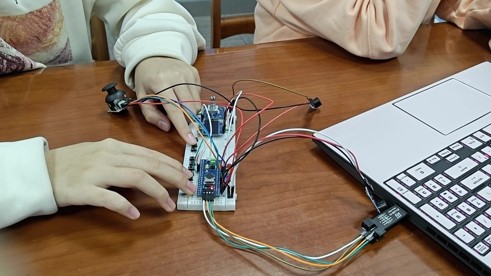

我希望这几个按键能承载更多演奏变化。比如同一段旋律可以换个调，某个片段可以临时升高八度；选好一段伴奏后，琴键继续弹旋律，摇杆再切换和弦。每加进一种操作，就多出一组需要协调的关系：这个动作改哪个变量，声音什么时候更新，屏幕上又应该显示什么。程序的结构也因此围绕一次完整演奏展开。

这些需求在代码中分成了两种模式。音色模式负责声音和音域设置，伴奏模式负责风格、速度与音轨。旋转编码器用来调参数，摇杆用来选和弦，OLED 把内部状态显示出来，三颗 LED 则随拍组变化。它们围绕同一次演奏工作，各自承担一部分任务。


| 想完成的操作 | 程序中的对应部分 |
|---|---|
| 用七个琴键弹奏 | EXTI 检测边沿，按琴键位置查 `scale` |
| 改变音色和音域 | `voice`、`tsp`、`sft`、`oct`、`sharp` |
| 选择伴奏风格 | `style` 选择六套事件数组之一 |
| 让伴奏跟随和弦变化 | 摇杆采样更新 `chordType`，`chord()` 计算琶音频率 |
| 看清当前设置 | `mode`、`knob` 和 OLED 显示函数 |


这些功能共用一块控制板，却走着不同的信号路径。先把连接关系理顺，后面的代码才有清楚的落点。

<a id="chapter-2"></a>
## 02 先把硬件连接起来

整机连接首先要解决资源分配。STM32F103C8 上的定时器可以产生声音，ADC 可以读取摇杆，外部中断则适合捕捉琴键的按下和松开。我按这些用途安排引脚，再把连接关系落实到初始化函数里。工程配置了 64 KiB Flash、20 KiB SRAM，系统时钟选择 72 MHz。

两路声音分别交给 TIM2 和 TIM3。这样，旋律换音时可以更新自己的定时器，伴奏也有独立的输出。OLED 则通过 GPIO 模拟 I²C；琴键和功能键占用数字输入，摇杆的两个方向量进入 ADC。把这些资源分开之后，应用层就可以通过几个清楚的接口使用它们。

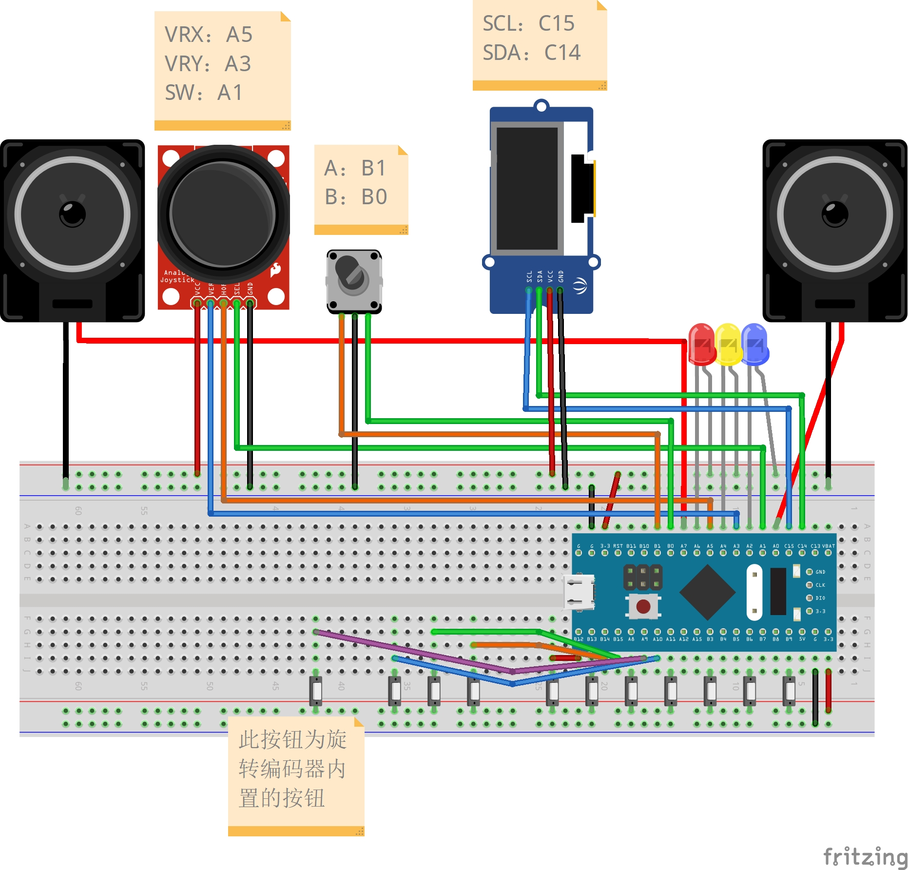

| 部件 | 引脚及外设 | 连接与作用 |
|---|---|---|
| 旋律输出 | PA0 / TIM2_CH1 | 复用推挽输出，产生旋律 PWM |
| 伴奏输出 | PA7 / TIM3_CH2 | 第二路 PWM，播放鼓点与琶音 |
| 七个琴键，从左到右 | PB12、PB13、PA8、PA11、PB3、PB6、PB9 | 下拉输入，按下接高电平 |
| 屏幕下方三键 | PA10、PB15、PB14 | 演奏时控制降八度、升八度和升半音 |
| 编码器按键 | PA9 | 设置时切换旋钮任务，播放中请求结束 |
| 编码器两相 | PB0、PB1 / EXTI0、EXTI1 | 上拉输入，下降沿触发，读取另一相判断方向 |
| 摇杆 X、Y | PA5 / ADC1_IN5；PA3 / ADC1_IN3 | 读取两轴模拟电压 |
| 摇杆按压 | PA1 | 上拉输入，按下为低电平 |
| OLED | PC15 / SCL；PC14 / SDA | 开漏输出，模拟 I²C 时序 |
| 三颗 LED | PA6、PA4、PA2 | 负极接控制引脚，输出低电平时点亮 |

这里有几处细节会直接影响后续代码。琴键按下读到 1，摇杆按压却读到 0，所以 `JoyStick_GetSW()` 先把低电平转换成“按下返回 1”，主程序就可以按操作含义使用这个结果。LED 同样是低电平有效，`LED_ON_A()` 内部调用的是清零输出位的函数。把这些差别封装在驱动里，读主程序时就不用反复回忆接线的极性。

第五个琴键用到了 PB3。这个引脚还承担 JTAG 功能，因此 `Keyboard_Init()` 先开启 AFIO，再调用 `GPIO_PinRemapConfig(GPIO_Remap_SWJ_JTAGDisable, ENABLE)` 释放 JTAG 引脚，同时保留 SWD 调试接口。引脚编号、复用功能和初始化顺序需要放在一起理解。[键盘初始化](firmware/Hardware/Keyboard.c#L5)

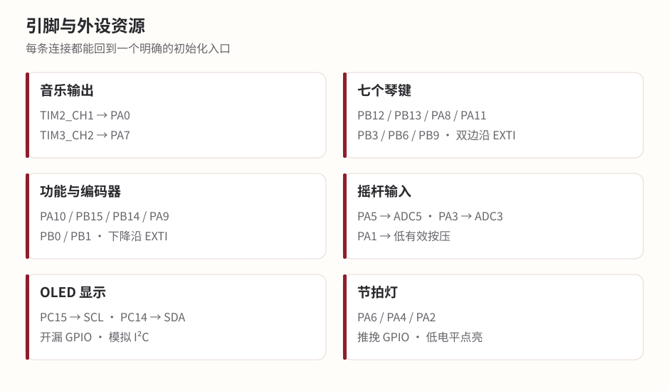

GPIO 模式也随部件而不同：模拟输入选 `AIN`，让 ADC 采样电压；PWM 选 `AF_PP`，由定时器控制输出；LED 选普通推挽；OLED 选开漏，通过拉低或释放总线形成通信时序。配置中的 `GPIO_Speed_50MHz` 设置输出驱动速度等级，音乐频率则由定时器的周期和预分频共同决定。

这份连接表也决定了上电后的准备工作。`main()` 依次初始化 LED、功能键、声音、OLED、编码器、琴键和摇杆；LED 先置高熄灭，PWM 比较值先清零。等这些初始状态确定下来，程序再进入操作循环，等待第一次琴键输入。[主函数](firmware/User/main.c#L563)

<a id="chapter-3"></a>
## 03 按下琴键之后，声音怎样产生

按下最左边的琴键时，PB12 从低电平变成高电平，EXTI12 随即产生中断。顺着这次输入看下去，会经过 `EXTI15_10_IRQHandler()`、音高计算和 `Buzzer_ON()`，最后落到定时器的几个寄存器上。一声简单的琴音，就是沿着这条路径产生的。

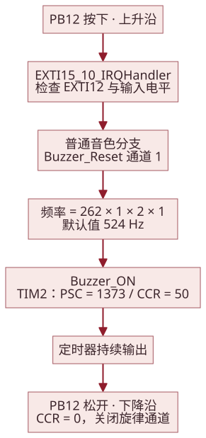

### 把一次按键换算成 524 Hz

琴键频率由下面这条表达式得到：

```c
uint16_t freq = scale[0+sft] * transpose[tsp]
              * pow(2, oct) * pow(1.06, sharp);
```

默认的 `sft=3`、`tsp=5`、`oct=1`、`sharp=0` 代入后，结果是 `scale[3]×1×2×1`，也就是 `262×2=524 Hz`。`voice=1` 又从占空比表中取出 50，于是这次调用可以理解为 `Buzzer_ON(524,50,1)`：以 524 Hz、50% 占空比开启旋律通道。[第一琴键的处理代码](firmware/User/main.c#L779)

音高和占空比确定后，持续发声的工作就交给了定时器。CPU 可以回去处理其他操作，下一次琴键边沿到来时再更新声音。

### 定时器怎样得到这个频率

PWM 的一个周期，就是定时器从 0 数到 ARR 的过程。PSC 先对定时器时钟分频，决定“数一步需要多久”；ARR 决定“数多少步算一个周期”。因为计数从 0 开始，公式中两项都需要加 1：

```text
PWM 频率 = 定时器时钟 / (PSC + 1) / (ARR + 1)
占空比   = CCR / (ARR + 1)
```

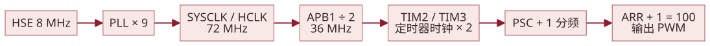

当前系统时钟为 72 MHz，APB1 分频后为 36 MHz；在这个分频配置下，TIM2 和 TIM3 的定时器时钟又乘 2，回到 72 MHz。代码把 `ARR` 固定为 `100-1=99`，每个周期正好有 100 个计数位置。这个取值带来一个方便之处：CCR 写 50 就是 50%，写 10 就是 10%，音色表中的数字可以直接送给比较寄存器。

频率变化交给 PSC：

```c
uint16_t psc = 720000 / freq - 1;
TIM_PrescalerConfig(TIM2, psc, TIM_PSCReloadMode_Update);
```

其中 `720000` 来自 `72,000,000÷100`。对刚才的 524 Hz，整数计算得到 `PSC=1373`，按 72 MHz 时钟换算，输出约为 524.017 Hz。这里既有整数除法，也有寄存器位宽，理解最后得到的频率时，需要沿计算结果一直看到实际写入的值。[PWM 实现](firmware/System/PWM.c#L3)

初始化时，驱动先用 `PSC=719` 配出 1000 Hz 的周期，并让 `CCR=0` 保持静音。每次发声前的 `Buzzer_Reset()` 会把计数器设到 51，放在当前最大音色比较值 50 之后；它还传入一次频率值 1，该值经 16 位 `psc` 转换得到 64639，对应约 11.139 Hz 的临时预分频配置。紧接着的 `Buzzer_ON()` 再写入目标音符参数。

松开 PB12 时，下降沿再次进入中断。此时输入为低，处理函数把旋律通道的 CCR 清零，声音结束。按下与松开两个边沿，正好构成一个音符的开始和结束。

<a id="chapter-4"></a>
## 04 七个琴键，怎样覆盖更多音域

七个琴键能弹出一组音，但旋律未必总落在这组音域里。继续增加按键会占用更多引脚和空间，于是我把音域变化放到了计算过程里：琴键仍然表示七个位置，具体音高由音阶表和当前参数一起决定。

`scale` 有 13 项，从 G3 到 E5，保存各自然音的整数近似频率。七个琴键连续读取其中七项，`sft` 决定从哪里开始。默认 `sft=3`，第一个键读 262，后面的键依次读 294、330、349、392、440、494。配合默认的八度倍率 2，实际请求频率就是 **524、588、660、698、784、880、988 Hz**。

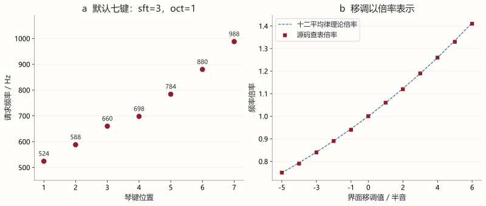

13 项音阶表与 0—6 的平移范围是一对配合的设置。七键中的最后一个索引为 `6+sft`，最大到 12，正好落在表尾；这让七个键无论移到哪个允许的位置，都能从表中取到对应音符。

| 参数 | 默认值与范围 | 控制的变化 |
|---|---|---|
| `sft` | 3；0—6 | 沿自然音阶移动七键窗口，屏幕显示 −3 至 +3 |
| `tsp` | 5；0—11 | 整组音符乘同一倍率，屏幕显示 −5 至 +6 半音 |
| `oct` | 1；0、1、2 | 分别乘 1、2、4，相对默认音域降低或提高八度 |
| `sharp` | 0；0、1 | 按住时再乘 1.06，松开后恢复 |

平移和移调听起来相近，在代码里做的事却不同。`sft` 移动的是数组位置，相邻自然音之间有全音也有半音；`tsp` 改变的是统一倍率，所有琴键一起升高或降低。十二平均律的半音比为 `2^(1/12)`，约 1.059463，当前 `transpose` 用两位小数保存近似倍率，升半音按键则使用 1.06。乘法得到的结果赋给 `uint16_t freq` 时会截去小数，然后再进入 PSC 的整数换算。

以第一个键为例，将 `tsp` 从 5 调到 7，倍率从 1 变成 1.12，`524×1.12=586.88`，保存为 586 Hz。保持默认移调，按住升八度键再弹奏，它变成 1048 Hz；只按住升半音键，则按 `524×1.06` 得到 555 Hz。屏幕上的选项到这里都有了具体的计算含义。参数在琴键按下时读取，因此音域调整作用于随后触发的音符。

### 伴奏里的和弦也从数组开始

和弦需要同时考虑音程结构和根音。`chord(number)` 先根据 `chordType` 选大三、小三或属七结构，再乘根音倍率。`number` 指定要取和弦中的第几个音：0 表示休止；非零值先减 1，用 `%4` 取四音之一，再用 `/4` 确定是否升高八度。这样，同一段琶音只要改变 `chordType`，就能按新的和弦发声。

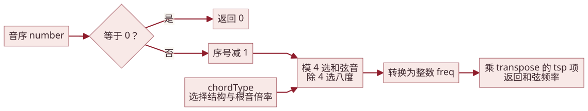

| 编号 | 和弦 | 基础数组 | 根音倍率 |
|---|---|---|---|
| 0 | C | `major={131,165,196,262}` | 1 |
| 1 | Dm | `minor={131,156,196,262}` | `transpose[7]=1.12` |
| 2 | Em | `minor` | `transpose[9]=1.26` |
| 3 | E7 | `seventh={131,165,196,233}` | `transpose[9]=1.26` |
| 4 | F | `major` | `transpose[10]=1.33` |
| 5 | G | `major` | `transpose[0]=0.75` |
| 6 | G7 | `seventh` | `transpose[0]=0.75` |
| 7 | Am | `minor` | `transpose[2]=0.84` |

小三和弦把第三音从 165 改为 156；属七结构把第四项从上八度根音 262 换成降七度 233。G 和 Am 使用向下移动的倍率，让根音落在较低音区。函数把这一阶段的结果存入整数 `freq`，最后再乘全局移调倍率返回。旋律和伴奏共享 `tsp`，而 `sft`、`oct`、`sharp` 留给琴键演奏使用。[和弦函数](firmware/User/main.c#L59)

<a id="chapter-5"></a>
## 05 同一个音高，也能有不同的声音

音域扩展以后，我还希望同一段旋律能有不同的声音感觉。频率决定音高，PWM 的脉冲宽度则提供了另一个可以调整的量。`voiceDuties` 保存了 50、40、30、20、10 五个占空比，对应界面中的 Clarinet、Pipe Organ、Accordion、Oboe、Trumpet。每换一项，输出周期保持原来的音高，高电平所占的比例发生变化，谐波组成和听感也随之改变。

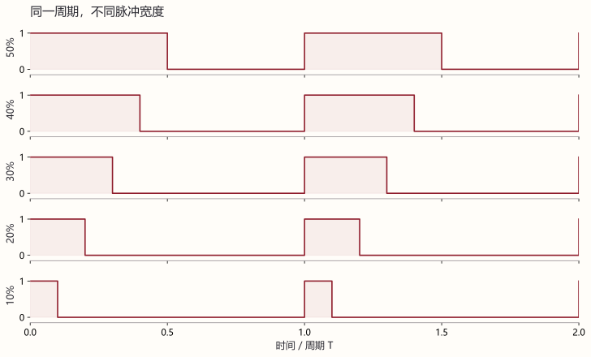

界面编号从 1 开始，所以访问数组时使用 `voice-1`。第六项 Drums 单独进入鼓组分支；琶音的 `arpVoice` 则只在 1—5 中选择。主旋律和伴奏因此可以使用不同的占空比设置。

鼓声的处理更接近一小段声音编排。低音鼓是一段低频脉冲，通鼓的频率逐步下降，小军鼓则快速交替两组频率。它们都集中在 `Buzzer_Drum(type)` 中，调用者只需给出一个编号。[鼓组实现](firmware/Hardware/Buzzer.c#L98)

| 编码 | 声音 | 一次调用做什么 |
|---|---|---|
| 0 | 休止 | 等待 30 ms，保持时间位置 |
| 1 | 低音鼓 | 80 Hz、50% 占空比，持续 30 ms |
| 2 | 小军鼓 | 600 Hz/50% 与 1200 Hz/30% 交替，各 1 ms，重复 15 次 |
| 3 | 闭合踩镲 | 3000 Hz、10%，30 ms 后关闭 |
| 4 | 开放踩镲 | 3000 Hz、10%，等待 30 ms 后交给后续事件处理 |
| 5 | 高通鼓 | 500 到 471 Hz，每下降 1 Hz 等待 1 ms |
| 6 | 中通鼓 | 400 到 371 Hz，使用相同扫描方式 |
| 7 | 低通鼓 | 300 到 271 Hz，使用相同扫描方式 |
| 8 | 高 Agogo | 900 Hz、10%，持续 30 ms |
| 9 | 低 Agogo | 600 Hz、10%，持续 30 ms |

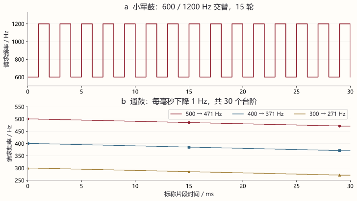

这些鼓声的形状不同，却都按 30 ms 的片段安排。小军鼓把时间分成 15 轮，每轮两个 1 ms；通鼓分成 30 个频率台阶。有了共同的长度，伴奏就可以先播放鼓声，再把这一子步剩下的时间留给琶音或等待。声音接口由此能够接进统一的节奏。

鼓组使用通道 2。选择鼓组音色以后，七个琴键触发不同编号；按住升半音键时，第六、第七键切换成两种 Agogo。琴键鼓声后还有 70 ms 的等待。进入伴奏模式时，主程序将鼓组音色恢复为普通音色 1，让琴键回到旋律通道，配合另一通道的伴奏演奏。

<a id="chapter-6"></a>
## 06 给旋律配上一段伴奏

琴键演奏由人决定下一音什么时候出现，伴奏则需要程序自己维持顺序和时间。六种风格的音符排列不一样，但都要处理和弦、速度和灯光。我把这部分共同规则留在 `acmpPlay()` 中，让每种风格提供自己的数组。这样，写一段新的伴奏，主要就是安排音序和鼓点。

### 用五组数组描述一段节奏

`acmp(style)` 根据风格编号创建五组局部数组。`arp` 写琶音的音序，`drums` 和 `cymbals` 写两条鼓轨，`fillDrums` 与 `fillCymbals` 写加花；后两组同时提供前奏的内容。主段数组长为 `number`，前奏和加花数组长为 `beat`。`acmpPlay()` 在调用期间使用这些数组，等播放结束才返回，数组的生命周期也与这一过程一致。

琶音数组中的 4，就是取当前和弦的第四个音；换了和弦，数组可以继续使用。鼓轨中的 1，则调用刚才的 30 ms 低音鼓。数组里的 0 留出休止位置。把这些编码连起来，就形成了一段能够循环的音乐。

默认 8Beat 的第一步可以完整算一遍：`drums[0]=1`，先播放 30 ms 低音鼓；`arp[0]=4`，在 C 和弦下得到 `chord(4)=262 Hz`。120 BPM 时，这个子步分配到 250 ms，鼓声之后剩余 220 ms 用来播放琶音。两者完成后，程序关闭伴奏通道和 LED，读取速度及结束按键，再进入下一步。

从这个 250 ms 的子步往前看，声音内容来自数组，音高来自和弦，时长来自速度设置。它们在播放函数中汇合，再成为一次具体的输出。

### 一拍怎样分成若干子步

`tempo` 默认 120 BPM，范围 40—240，每次旋转调整 5。按照一分钟 60000 ms 计算，一个四分音符的时长是 `60000/tempo`。在这个基础上，代码用 `beat` 选择八分、十六分或三连音细分。

| 风格 | `number` | `beat` | 单步时长公式 | 120 BPM 下单步 / 序列标称时长 |
|---|---:|---:|---|---|
| 8Beat | 16 | 8 | `30000/tempo` | 250 ms / 4000 ms |
| 16Beat | 32 | 16 | `15000/tempo` | 125 ms / 4000 ms |
| Slow Rock | 24 | 12 | `20000/tempo` | 166 ms / 3984 ms |
| Swing | 12 | 12 | `20000/tempo` | 166 ms / 1992 ms |
| March | 32 | 16 | `15000/tempo` | 125 ms / 4000 ms |
| Waltz | 12 | 6 | `30000/tempo` | 250 ms / 3000 ms |

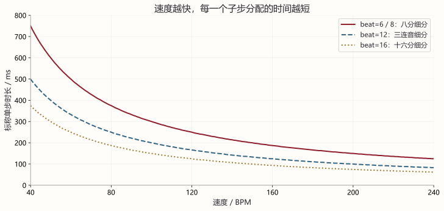

表中采用 C 的整数除法，所以 `20000/120` 保存为 166。`beat=12` 每三个子步组成一拍，四组构成一轮；`beat=6` 则是每两个子步一拍，共三拍。LED 使用的 `i/(beat/4)%4` 和 `i/2%3` 正是在做这件事：整数除法先找到当前拍组，取模再让组号循环。

有了单步时长，剩下的就是安排其中的声音。鼓加琶音时，先给第一鼓轨 30 ms，再把“单步时长减 30 ms”交给非零琶音；两条鼓轨时，各占 30 ms，剩余部分等待。即使某条轨关闭，代码也用等待填上原来的时间位置。240 BPM 的十六分细分经整数计算为 62 ms，双鼓轨占去 60 ms 后还剩 2 ms，这说明速度上限和鼓声长度是相互关联的。

琶音为 0 的分支另有两段等待。`beat=6/8` 是两次 `30000/tempo-30`；`beat=16` 是 `15000/tempo-30` 加 `30000/tempo-30`；`beat=12` 是 `20000/tempo-30` 加 `30000/tempo-30`。再加第一鼓轨对应的 30 ms，120 BPM 下分别得到 470、345、386 ms。Swing 和 March 含有这样的休止事件，读它们的时间安排时，需要把这条分支一起算进去。[播放时长的处理](firmware/User/main.c#L417)

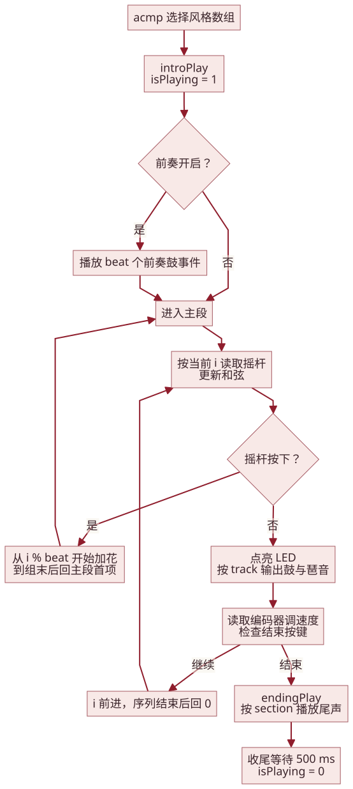

一个子步能够运行后，就可以把它放回整段伴奏。`introPlay()` 先把 `isPlaying` 置为 1，再按 `section` 决定是否播放前奏。主段通过外层循环反复运行，`i` 在每轮中从 0 遍历到 `number-1`。摇杆选择的新和弦会用于后续琶音；按下摇杆，则进入加花。

进入加花时，程序先计算 `n=i%beat`，找到当前位于拍组中的哪个子步，再从这里播放到组末。结束后退出当前遍历，下一轮回到主段首项。这样，一次操作能够接入正在进行的节奏。

编码器按键触发结束路径后，`endingPlay()` 按段落设置处理尾声。启用琶音时，四个和弦音各播放 60 ms；纯鼓组合则等待 240 ms，占据相同的位置。最后再等待 500 ms，将 `isPlaying` 清零并整理屏幕，程序回到伴奏设置界面。三颗 LED 在这个过程中标记拍组：主段第一拍三灯同亮，其余拍分别指示；Waltz 前奏采用两灯组合。

六种风格、三种音轨组合和四种段落设置，都沿用这套播放过程。具体的事件排列完整列在附录，可以继续对照每个鼓点和琶音阅读。

<a id="chapter-7"></a>
## 07 演奏时，怎样操作这些功能

当音色、音域和伴奏都能设置时，操作方式就变得重要了。屏幕下方只有三个按键，旋转编码器也只提供旋转和按压；给每项功能各分配一个按钮并不现实。我把操作按场景分开：选音色时调整音色参数，准备伴奏时选择风格和音轨，开始演奏后，几个功能键再用于临时改变音高。


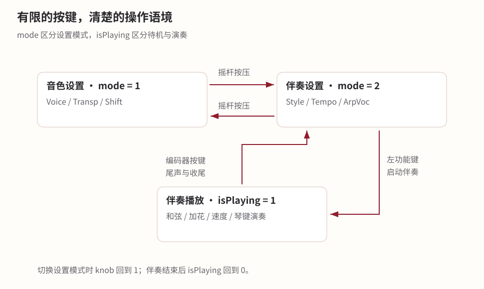

| 操作 | 音色模式 | 伴奏待机 | 伴奏播放中 |
|---|---|---|---|
| 编码器按压 PA9 | 选择 Voice / Transp / Shift | 选择 Style / Tempo / ArpVoc | 请求结束 |
| 旋转编码器 | 修改当前选项 | 修改当前选项 | 调整速度 |
| 左功能键 PA10 | 按住降八度 | 启动伴奏 | 按住降八度 |
| 中功能键 PB15 | 按住升八度 | 切换音轨组合 | 按住升八度 |
| 右功能键 PB14 | 按住升半音 | 切换前奏/尾声组合 | 按住升半音 |
| 摇杆按压 PA1 | 切到伴奏模式 | 切到音色模式 | 触发加花 |
| 摇杆偏转 | — | — | 启用琶音时选择和弦 |

旋钮选项还有一个值得区分的地方。音色和风格是一个列表，转到最后一项后回到第一项，用起来方便；速度和移调有明确上下限，到边界后保持即可。`Encoder_Var(var,step,min,max,setL,setH)` 用同一接口表达这两种行为：越界后回到另一端，就是循环；越界后取当前边界，就是限幅。调用者通过参数选择规则，函数本身可以复用。

### 摇杆的位置怎样成为和弦

摇杆给出的是连续电压，而和弦只有八种选择。ADC 把电压转换成 0—4095 的数值后，程序用 1024 和 3072 划出低、中、高三个区域。两轴组合起来是九宫格，外侧八格对应八个和弦，中心保持上一次选择。

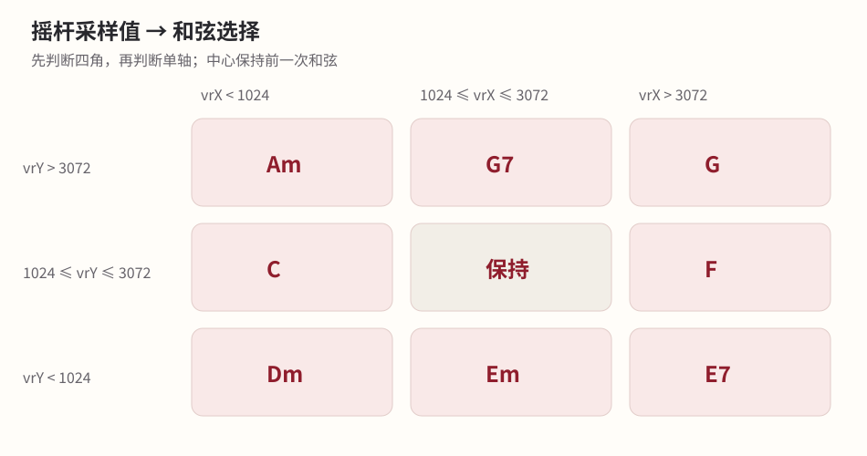

判断先检查四个角，再检查单轴方向。这样，两轴同时偏离中心时，就能进入对角区域。阈值条件采用严格小于或大于，恰好等于 1024、3072 时仍留在该轴的中间范围；模块安装朝向会改变物理方向，因此图中直接用 `vrX` 和 `vrY` 数值表示位置。

`JoyStick_GetX()` 读取通道 5，`JoyStick_GetY()` 读取通道 3。ADC 采用单次软件触发，先选择通道，再启动转换、等待 EOC，最后取结果。时钟为 `PCLK2/6=12 MHz`，采样设为 55.5 周期，加上 12.5 周期转换时间，单次硬件转换约为 5.67 μs。两轴依次读取，便于在每个伴奏事件开始时获得当前选择。[ADC 驱动](firmware/Hardware/AD.c#L3)

### 屏幕把操作和状态连起来

OLED 的任务是把内部变量变成可读的信息。`mode` 说明现在处于哪个界面，`knob` 说明旋钮正在调什么，具体参数显示在固定位置。比如 `tsp` 内部是 0—11，显示时减去 5，演奏者看到的就是 −5 至 +6。

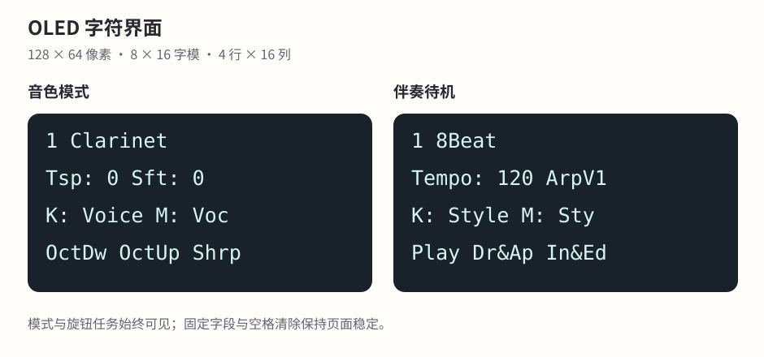

驱动把 128×64 像素屏幕按 8×16 字模排成四行、每行 16 字符。显示一个字时，先写上半部八字节，再写下半部八字节；`(Line-1)*2` 得到页号，`(Column-1)*8` 得到列地址。速度使用三位，琶音音色使用一位；切换到较短的名称前先用空格清除原区域，页面就能保持整齐。

这些文字最终通过 PC14、PC15 模拟的 I²C 发给屏幕。地址字节 `0x78` 由七位地址 `0x3C` 加写方向位构成，`0x00` 选择命令，`0x40` 选择图像数据。发送函数从最高位开始写八位，再产生第九个时钟；当前驱动的这一步直接提供时钟，未读取应答位。完整的初始化命令及各字节作用列在附录。

<a id="chapter-8"></a>
## 08 程序里的几件事如何同时进行

单独运行一个模块时，执行顺序比较容易看清。真正把伴奏和琴键接在一起，就要考虑两者如何配合：主程序正在等待一段鼓声结束，手指可能已经按下下一个音；界面还要更新，而声音也要持续输出。这里需要的是让各部分各司其职。

我让主程序组织设置和伴奏，用外部中断捕捉琴键，再由定时器维持波形。琴键边沿到来时，CPU 暂停当前代码，更新旋律通道后返回；发声本身仍由定时器按已经写入的参数继续执行。

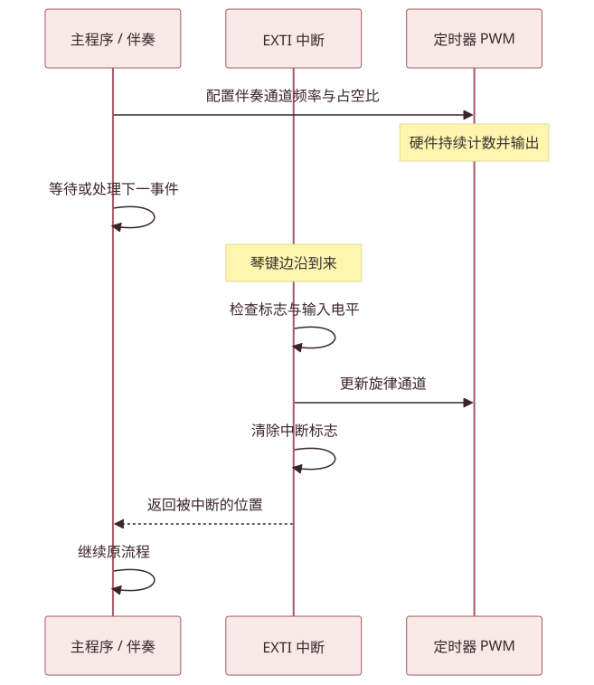

`main()` 的循环在音色和伴奏设置之间分流。启动伴奏后，执行进入 `acmpPlay()`，等它结束才返回；与此同时，琴键中断仍然可以更新旋律通道。NVIC 使用 PriorityGroup_2，编码器的抢占优先级为 1，琴键为 2，数值较小者优先。编码器两路的子优先级为 1 和 2，琴键三组均为 2，用来决定同抢占级同时待处理时的服务顺序。

共享中断入口还需要进一步辨认触发线。代码在 `EXTI9_5_IRQHandler()` 和 `EXTI15_10_IRQHandler()` 中按 `if/else if` 顺序检查标志，一次处理一个分支，随后清除对应标志；其他待处理请求可以继续进入服务。旋律输出保存一组频率与占空比，因此琴键事件依次更新同一通道，松键事件关闭该通道。

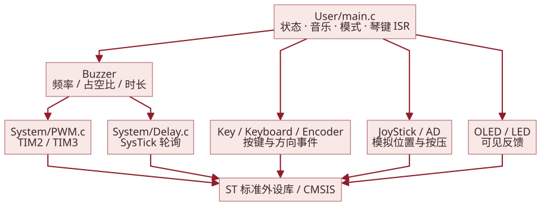

按职责看，`User/main.c` 管状态与音乐流程，`Hardware` 提供部件接口，`System` 提供 PWM 和延时，`Library`、`Start` 则提供标准库、CMSIS、时钟和启动代码。这个分层在调用处很直观：`Buzzer_ON()` 接收声音参数，`JoyStick_GetX()` 返回位置，`LED_ON_A()` 点亮指示灯。上层按功能使用接口，底层集中处理硬件细节。

有些资源需要特别留意它的读写位置。`Encoder_Count` 保存最近一次方向事件，中断写入 +1 或 −1，主程序读取并清零。`oct`、`sharp` 由功能键中断修改，琴键按下时读出；其他菜单参数主要由主循环更新。这些变量把不同执行位置连接起来，所以查看一个变量时，最好同时找到“谁写它”和“谁使用它”。

延时使用的也是一个共享资源。`Delay_us()` 给 SysTick 写入 `LOAD=72*xus`，清空 VAL 后，用 `CTRL=0x5` 启动 HCLK 计数，轮询 `0x10000` 的 COUNTFLAG，结束后写 `0x4` 关闭计数。毫秒和秒接口各用一层循环进行 1000 倍换算。主程序与中断里的延时会操作同一个 SysTick，鼓声调用、显示更新也占用执行时间，这些因素一起构成了系统的运行时序。

<a id="chapter-9"></a>
## 09 把各部分接起来，再一步步调通

模块越来越多以后，调试也不再局限于某个函数。一项功能有没有正常工作，往往要连着看几处代码：按键电平是否进入程序，状态是否改变，算出的频率是否送到了正确通道。我逐渐习惯沿着这条路径排查，把一个笼统的现象拆成几个具体问题。

动手前，我会先把目标拆成几项子任务，将模块职责、输入输出和调用关系写进技术文档。实现过程中遇到思路中断，就回到这份文档补齐遗漏的条件。出现问题时，先核对工程路径、地址、引脚和接口，再进入相关模块检查。输入端先确认引脚、电平和中断映射；应用端看 `mode`、`knob` 和相关参数有没有按预期变化；计算端代入具体数值，检查索引、倍率、预分频；最后看声音、屏幕和灯光是否对应同一次操作。每走过一层，就能把排查范围再缩小一些。

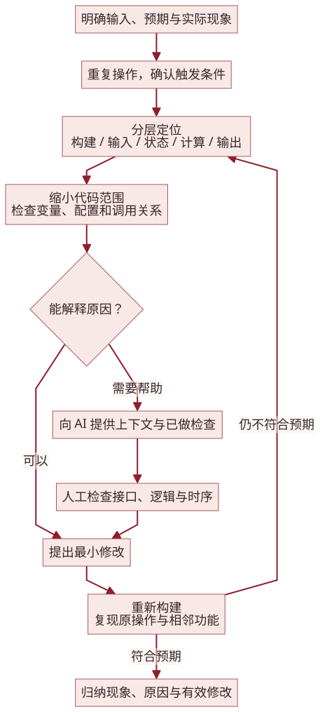

节拍与灯光联动就是一个适合这样拆解的例子。`beat` 看起来只是一个数字，却同时参与步长、拍组和加花边界的计算。调试时，先把一轮 `i` 的取值写出来，再计算 `i/2%3` 或 `i/(beat/4)%4`，就能看到每几个子步换一次灯、多少拍后循环。把这张表和实际灯光、声音放在一起观察，音乐概念就变成了可以逐项检查的程序行为。

Keil 工程设置调整则提醒我，代码的运行还依赖构建环境。项目曾通过调整工程设置解决构建问题；排查这类情况时，先看第一条报错，分清是编译还是链接，再检查头文件路径、源文件列表、目标器件和编译器版本。当前工程使用 ARMCC 5.06，器件为 STM32F103C8，重新运行时也从这些配置入手。

还有一类问题来自实际连接。采购元件与原方案存在差异，电路连接也随之调整，我需要同时核对程序里的引脚和有效电平。接线改动以后，先确认单个部件的输入输出，再恢复整机流程，能让问题更容易定位。软件和硬件在这里是同一条链路上的两部分。

### 遇到自己暂时解决不了的问题

我通常会先自己检查逻辑和报错，做小范围尝试。语法或接口问题一时没有头绪时，再请 AI 帮忙分析。要让这一步有用，问题本身需要讲清楚：工具链是什么，在哪个函数出现什么现象，输入和预期分别是什么，已经检查了哪些地方。相关函数和调用点一起提供，才方便沿着数据流分析。

收到建议以后，我最关心的是它会怎样影响原来的程序。一个修改即使能够消除当前报错，也要继续看参数范围、返回值、状态切换、引脚和时序；涉及中断时，还要检查执行顺序和新增的等待。我会先理解建议的原因，再决定采用哪一部分。

验证也要跟着改动走。先重复触发原问题的操作，再检查容易受到影响的相邻功能。例如修改音高计算后，同时检查不同琴键、移调和伴奏和弦；修改按键逻辑后，检查按下、松开、长按以及模式切换。这样的过程会留下一个清楚的结果：哪里出了问题，哪一处修改起了作用，其他功能是否仍按原来的方式工作。


单个问题处理完，还要回到真正的演奏过程里走一遍：上电查看默认参数，依次弹奏七键，切换音色与鼓组，调整移调和平移，试八度与半音键；随后进入伴奏模式，遍历六种风格、速度范围、三种音轨和四种段落组合，再操作摇杆和弦、加花与结束。屏幕、灯光和声音一起看，能帮助判断各模块是否真正接成了同一个系统。

<a id="chapter-10"></a>
## 10 打开工程，重新运行

如果想从代码继续理解这个项目，可以先打开 `main.c`，看全局状态和 `main()`，再沿着 `acmp()`、`acmpPlay()` 以及琴键中断进入具体功能。遇到发声和显示的细节，再转到对应驱动。这样比较容易把一段代码放回它实际参与的操作中。

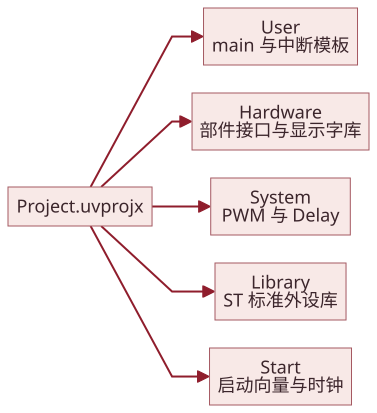

| 位置 | 内容 |
|---|---|
| `firmware/Project.uvprojx` | Keil 工程、目标器件和编译选项 |
| `firmware/User` | 主程序、音乐逻辑和中断入口 |
| `firmware/Hardware` | 按键、声音、OLED、编码器、ADC和摇杆驱动 |
| `firmware/System` | PWM 与延时 |
| `firmware/Start` | 启动向量、CMSIS、系统时钟 |
| `firmware/Library` | ST 标准外设库 |
| `assets` | 图、图源、照片、视频与页面样式 |
| `code` | 带行号的源码阅读页 |

### 构建与下载

1. 使用支持 ARM Compiler 5 的 Keil MDK，并安装 STM32F1 器件支持包。工程记录的工具链为 ARMCC V5.06 update 5（build 528），配套环境为 MDK 5.24 系列、STM32F1xx_DFP 2.2.0。
2. 打开 [Project.uvprojx](firmware/Project.uvprojx)，确认器件为 STM32F103C8。Flash 从 `0x08000000` 开始，长度 `0x10000`；SRAM 从 `0x20000000` 开始，长度 `0x5000`。
3. 检查 `Start、Library、User、System、Hardware` 五个包含目录，以及 `USE_STDPERIPH_DRIVER` 宏；启动文件为 `startup_stm32f10x_md.s`。
4. 执行 Rebuild，再选择本机 ST-LINK/SWD 与对应的 Flash 下载算法。按板卡要求连接供电、地线和调试接口，下载程序。
5. 上电后从默认界面和单键演奏开始，按上一章的顺序进行检查。

系统时钟在 `system_stm32f10x.c` 中配置：默认 `HSE_VALUE=8 MHz`，选择 PLL 倍频到 72 MHz，PWM 与延时按这个频率换算。2024 年的构建记录中，代码区为 20352 字节、只读数据 2152 字节、读写数据 212 字节、零初始化区 1636 字节，合计 Flash 约 22716 字节，RAM 静态占用约 1848 字节。

### 演示视频

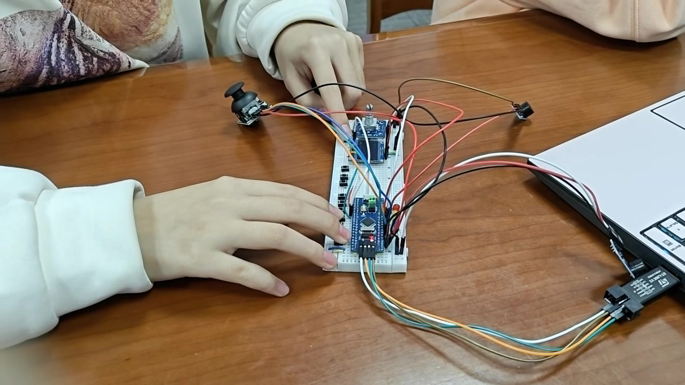

[观看短演示，约 15 秒](assets/video/demo-short.mp4) · [短片原文件](assets/video/demo-short-original.mp4)

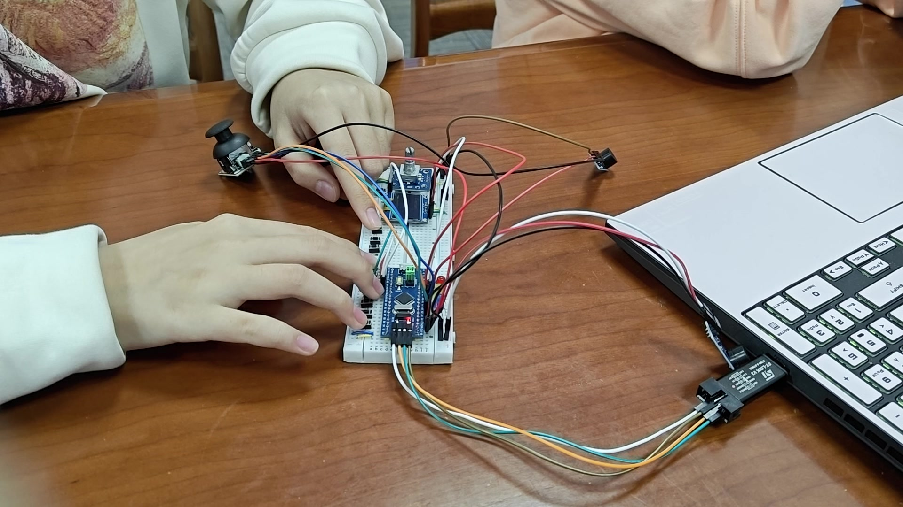

[观看完整演示，约 2 分 19 秒](assets/video/demo-full.mp4) · [下载原视频](https://github.com/woaijieyang/0001_electronic_organ_design/releases/download/v1.0.0/VID20241226160603.mp4)

[工程源码](firmware/Project.uvprojx) · [流程图源文件](assets/diagrams) · [文档维护](tools/README.md)

<a id="appendix"></a>
## 附录：变量、参数与配置索引

按模块和作用域查阅各变量的取值、用途与调整效果。每个条目都链接到对应代码。

<!-- GENERATED_APPENDIX -->

### A. 状态与基础数据


| 变量 | 类型、范围与默认值 | 读写位置 | 设置意义与影响 | 定位 |
| --- | --- | --- | --- | --- |
| `Encoder_Count` | int8_t；−1/0/+1，静态零初始化 | EXTI0/1赋+1/−1；Encoder_Get读取；Encoder_Clear清零 | 表示最近的方向事件。符号供step相乘，0表示当前无待处理方向；主程序处理后清零。 | [源码](firmware/Hardware/Encoder.c#L3) |
| `voice` | uint8_t；1—6，初值1 | 主程序由编码器更新；琴键中断读取；切入伴奏时将鼓组6复位为1 | 1—5索引五项占空比，6进入鼓组分支；1作为首个菜单项。改变它改变下一次按键的声音生成方式。 | [源码](firmware/User/main.c#L21) |
| `knob` | uint8_t；1—3，初值1 | 主循环按PA9递增；切换mode后重置1；参数分支读取 | 同一个旋钮选择三种任务，节省输入器件；值越界会脱离已有菜单分支。 | [源码](firmware/User/main.c#L22) |
| `tsp` | uint8_t；0—11，初值5 | 主循环限幅更新；琴键频率与chord读取；OLED显示tsp-5 | 5对应倍率1；增加一项约升半音，减小约降半音；旋律和和弦共享移调。 | [源码](firmware/User/main.c#L23) |
| `sft` | uint8_t；0—6，初值3 | 主循环限幅更新；七键频率计算读取；OLED显示sft-3 | 3使首键选scale[3]=262；最大6保证第七键索引12；改变自然音窗口而非统一半音移调。 | [源码](firmware/User/main.c#L24) |
| `oct` | uint8_t；0/1/2，初值1 | PA10/PB15边沿修改，松开恢复1；七键频率读取 | 对应1/2/4倍率；1是界面默认，按下降八度为0、升八度为2；下一次琴键发声时生效。 | [源码](firmware/User/main.c#L25) |
| `sharp` | uint8_t；0/1，初值0 | PB14边沿修改；旋律计算和第六/七鼓键读取 | 0时倍率1，1时乘1.06；鼓组下在6/8及7/9鼓编码间选择。 | [源码](firmware/User/main.c#L26) |
| `mode` | uint8_t；1/2，初值1 | 摇杆按压在主循环切换；主循环及功能键中断读取 | 1音色设置，2伴奏设置；把相同硬件映射到两组任务，切换时清屏并重置knob。 | [源码](firmware/User/main.c#L27) |
| `style` | uint8_t；1—6，初值1 | 主循环循环更新；显示和acmp(style)读取 | 1默认8Beat；不同编号选择不同局部序列和beat；编号必须与styleNames及六分支一致。 | [源码](firmware/User/main.c#L28) |
| `tempo` | uint16_t；40—240 BPM，初值120 | 主循环及前奏、加花、主段读取编码器后更新；时长公式读取 | 120对应四分音符500ms；步长5兼顾调节跨度与操作次数；增大使标称子步缩短。 | [源码](firmware/User/main.c#L29) |
| `chordType` | uint8_t；0—7，初值0 | 主段和尾声在启用琶音时由摇杆修改；chord和显示读取 | 0默认C；按八方向选择结构与根音；中心不写入，保持此前和弦。 | [源码](firmware/User/main.c#L30) |
| `isPlaying` | uint8_t；0/1，初值0 | introPlay置1，endingPlay末尾置0；功能键中断读取 | 即使关闭前奏仍在进入播放时置1；1使三功能键用于临时音高控制。 | [源码](firmware/User/main.c#L31) |
| `track` | uint8_t；0—2，初值0 | 伴奏待机的PB15更新；各播放函数读取 | 0第一鼓轨+琶音，1两条鼓轨，2仅琶音；控制调用或等待的分支，不增加硬件通道。 | [源码](firmware/User/main.c#L32) |
| `section` | uint8_t；0—3，初值0 | 伴奏待机的PB14更新；introPlay/endingPlay读取 | 0前奏+尾声，1仅前奏，2仅尾声，3均关闭；主段播放仍存在。 | [源码](firmware/User/main.c#L33) |
| `arpVoice` | uint8_t；1—5，初值1 | 伴奏待机旋钮循环更新；主段和尾声读取 | 只索引5项旋律占空比，独立于voice；增加编号使脉冲占空比从50%逐步减至10%。 | [源码](firmware/User/main.c#L34) |


#### `scale`

uint16_t[13]，单位Hz；七键读取索引k+sft，13项覆盖7键与0—6平移窗口；数值增大使相应基础音更高。 [源码](firmware/User/main.c#L37)

```c
uint16_t scale[] = {196,220,247,262,294,330,349,392,440,494,523,587,659};
```

#### `transpose`

float[12]；对应−5至+6半音的近似倍率；琴键和和弦计算读取，索引5为1.0；更改数值会同时改变相关移调和以该表构造的和弦根音。 [源码](firmware/User/main.c#L40)

```c
float transpose[] = {0.75,0.79,0.84,0.89,0.94,1.0,1.06,1.12,1.19,1.26,1.33,1.41};
```

#### `voiceDuties`

uint8_t[5]，单位%；voice/arpVoice减1索引；每项是CCR值，ARR+1=100；降低数值缩短高电平脉冲并改变谐波。 [源码](firmware/User/main.c#L44)

```c
uint8_t voiceDuties[5] = {50,40,30,20,10};
```

#### `voiceNames`

char*[6]；voice−1索引的界面名称；字符串长度决定清除旧文字区域的需要；顺序应与声音分支一致。 [源码](firmware/User/main.c#L47)

```c
char * voiceNames[6] = {"Clarinet","Pipe Organ","Accordion","Oboe","Trumpet","Drums"};
```

#### `styleNames`

char*[6]；style−1索引的伴奏名称；改变文字只影响显示，改变编号顺序需要对应acmp分支。 [源码](firmware/User/main.c#L48)

```c
char * styleNames[6] = {"8Beat","16Beat","Slow Rock","Swing","March","Waltz"};
```

#### `trackStatus`

char*[3]；track索引；Dr&Ap、Drums、Arpgo分别概括鼓+琶音、双鼓、琶音；短标签适配5字符区域。 [源码](firmware/User/main.c#L49)

```c
char * trackStatus[3] = {"Dr&Ap","Drums","Arpgo"};
```

#### `sectionStatus`

char*[4]；section索引；In&Ed、Intro、Endng、OFF；填充空格覆盖旧文字，状态值决定前尾奏组合。 [源码](firmware/User/main.c#L50)

```c
char * sectionStatus[4] = {"In&Ed","Intro","Endng"," OFF "};
```

#### `chordNames`

char*[8]；chordType索引；两字符宽，C/F/G补空格；文字与八个和弦分支对应。 [源码](firmware/User/main.c#L51)

```c
char * chordNames[8] = {"C ","Dm","Em","E7","F ","G ","G7","Am"};
```

### B. 每个函数的接口与参数

各函数按模块列出职责、参数和返回值。

#### `AD_Init`

使能GPIOA和ADC1，选择12MHz ADC时钟，单通道软件触发，并在启用后复位校准、启动校准。 [源码](firmware/Hardware/AD.c#L3)

```c
void AD_Init(uint16_t pins);
```


| 参数 | 含义、使用方式与变化影响 |
| --- | --- |
| `uint16_t pins` | 引脚位掩码，可用按位或组合；对应端口由函数名/实现固定。初始化函数写配置，读函数查询输入，LED函数写输出；改变掩码会改变实际参与操作的引脚。 |


#### `AD_GetValue`

选择一个规则通道，55.5周期采样，软件触发后等待EOC，返回12位转换值。 [源码](firmware/Hardware/AD.c#L32)

```c
uint16_t AD_GetValue(uint8_t ADC_Channel);
```


| 参数 | 含义、使用方式与变化影响 |
| --- | --- |
| `uint8_t ADC_Channel` | 本项目调用值为ADC_Channel_5或ADC_Channel_3；在规则序列第1位配置，决定读取哪条模拟输入，返回值单位为ADC计数。 |


#### `Buzzer_Init`

初始化TIM2/CH1与TIM3/CH2两路PWM。 [源码](firmware/Hardware/Buzzer.c#L5)

```c
void Buzzer_Init(void);
```

#### `Buzzer_OFF`

按通道将比较值设为0，PWM波形转为静音状态。 [源码](firmware/Hardware/Buzzer.c#L15)

```c
void Buzzer_OFF(uint8_t channel);
```


| 参数 | 含义、使用方式与变化影响 |
| --- | --- |
| `uint8_t channel` | 取0/1/2：同时操作两路/旋律TIM2/伴奏TIM3；由调用者选择并在函数分支读取，改变它会把声音或静音动作送到不同输出。 |


#### `Buzzer_ON`

目标频率非零时设置频率和占空比；零频率通过静音处理，避免进入频率除法。 [源码](firmware/Hardware/Buzzer.c#L35)

```c
void Buzzer_ON(uint16_t freq, uint8_t tone, uint8_t channel);
```


| 参数 | 含义、使用方式与变化影响 |
| --- | --- |
| `uint16_t freq` | 单位Hz，uint16_t输入；Buzzer_ON以0表示静音，正数送到PWM预分频计算；更高值使计数周期缩短。PWM_SetFreq自身要求非零。 |
| `uint8_t tone` | 单位%，本项目旋律为50/40/30/20/10，鼓声使用50/30/10；送入CCR，在固定ARR=99下直接决定高电平计数数目。 |
| `uint8_t channel` | 取0/1/2：同时操作两路/旋律TIM2/伴奏TIM3；由调用者选择并在函数分支读取，改变它会把声音或静音动作送到不同输出。 |


#### `Buzzer_Timing`

开启声音，阻塞等待timing毫秒，然后关闭指定通道。 [源码](firmware/Hardware/Buzzer.c#L65)

```c
void Buzzer_Timing(uint16_t freq, uint16_t timing, uint8_t tone, uint8_t channel);
```


| 参数 | 含义、使用方式与变化影响 |
| --- | --- |
| `uint16_t freq` | 单位Hz，uint16_t输入；Buzzer_ON以0表示静音，正数送到PWM预分频计算；更高值使计数周期缩短。PWM_SetFreq自身要求非零。 |
| `uint16_t timing` | 单位ms，uint16_t；由伴奏单步剩余时长或30/60传入，延时函数读取；增大会延长发声并推迟后续事件。 |
| `uint8_t tone` | 单位%，本项目旋律为50/40/30/20/10，鼓声使用50/30/10；送入CCR，在固定ARR=99下直接决定高电平计数数目。 |
| `uint8_t channel` | 取0/1/2：同时操作两路/旋律TIM2/伴奏TIM3；由调用者选择并在函数分支读取，改变它会把声音或静音动作送到不同输出。 |


#### `Buzzer_Reset`

换音前设置临时预分频并把CNT写为51，为随后发声准备计数位置。 [源码](firmware/Hardware/Buzzer.c#L76)

```c
void Buzzer_Reset(uint8_t channel);
```


| 参数 | 含义、使用方式与变化影响 |
| --- | --- |
| `uint8_t channel` | 取0/1/2：同时操作两路/旋律TIM2/伴奏TIM3；由调用者选择并在函数分支读取，改变它会把声音或静音动作送到不同输出。 |


#### `Buzzer_Drum`

将0—9鼓声编号解释为定频、交替频率或下降扫描动作。 [源码](firmware/Hardware/Buzzer.c#L98)

```c
void Buzzer_Drum(uint16_t type);
```


| 参数 | 含义、使用方式与变化影响 |
| --- | --- |
| `uint16_t type` | 鼓声编号0—9；0等待30ms，其他编号选择具体频率序列；无外部持久状态，在switch中读取。 |


#### `Encoder_Init`

配置PB0/1上拉、下降沿EXTI和NVIC，建立方向事件入口。 [源码](firmware/Hardware/Encoder.c#L5)

```c
void Encoder_Init(void);
```

#### `Encoder_Get`

返回当前方向事件−1/0/+1，不清零。 [源码](firmware/Hardware/Encoder.c#L40)

```c
int8_t Encoder_Get(void);
```

#### `Encoder_Clear`

把方向事件清零，表示主程序已消费。 [源码](firmware/Hardware/Encoder.c#L44)

```c
void Encoder_Clear(void);
```

#### `Encoder_Var`

执行var+=方向×step，按上下界映射setL/setH，清除事件后返回新值。 [源码](firmware/Hardware/Encoder.c#L58)

```c
int16_t Encoder_Var(int16_t var, int8_t step, int16_t min, int16_t max, int16_t setL, int16_t setH);
```


| 参数 | 含义、使用方式与变化影响 |
| --- | --- |
| `int16_t var` | int16_t当前值的局部副本；函数按step更新并返回，调用者赋回状态量才持久生效；采用有符号数便于处理负步长。 |
| `int8_t step` | int8_t步长；参数选择为1，速度为5；编码器方向与其相乘，改变符号反转调节方向，改变绝对值改变一次操作幅度。 |
| `int16_t min` | int16_t下限；更新后的var小于它时映射到setL；与数组可用索引或业务范围一致。 |
| `int16_t max` | int16_t边界；Encoder_Var中为上限；Key_Var_Plus中正步长检查上限、负步长检查下限；越界后采用指定返回位置。 |
| `int16_t setL` | 低于min后的返回值；等于min为下限保持，等于max为循环到末项；只在低端越界时读取。 |
| `int16_t setH` | 高于max后的返回值；等于max为上限保持，等于min为循环到首项；只在高端越界时读取。 |


#### `EXTI0_IRQHandler`

PB0下降沿且PB1为低时写入+1，再清除EXTI0标志。 [源码](firmware/Hardware/Encoder.c#L70)

```c
void EXTI0_IRQHandler(void);
```

#### `EXTI1_IRQHandler`

PB1下降沿且PB0为低时写入−1，再清除EXTI1标志。 [源码](firmware/Hardware/Encoder.c#L79)

```c
void EXTI1_IRQHandler(void);
```

#### `JoyStick_Init`

PA1上拉读取按压；初始化PA3/PA5模拟采样。 [源码](firmware/Hardware/JoyStick.c#L4)

```c
void JoyStick_Init(void);
```

#### `JoyStick_GetSW`

将低有效输入转换为按下1、松开0。 [源码](firmware/Hardware/JoyStick.c#L15)

```c
uint8_t JoyStick_GetSW(void);
```

#### `JoyStick_GetX`

读取ADC通道5；返回横轴命名对应的采样值。 [源码](firmware/Hardware/JoyStick.c#L22)

```c
uint16_t JoyStick_GetX(void);
```

#### `JoyStick_GetY`

读取ADC通道3；返回纵轴命名对应的采样值。 [源码](firmware/Hardware/JoyStick.c#L26)

```c
uint16_t JoyStick_GetY(void);
```

#### `Key_Init_A`

按函数对应的GPIO端口配置下拉输入。 [源码](firmware/Hardware/Key.c#L4)

```c
void Key_Init_A(uint16_t pins);
```


| 参数 | 含义、使用方式与变化影响 |
| --- | --- |
| `uint16_t pins` | 引脚位掩码，可用按位或组合；对应端口由函数名/实现固定。初始化函数写配置，读函数查询输入，LED函数写输出；改变掩码会改变实际参与操作的引脚。 |


#### `Key_Init_B`

按函数对应的GPIO端口配置下拉输入。 [源码](firmware/Hardware/Key.c#L15)

```c
void Key_Init_B(uint16_t pins);
```


| 参数 | 含义、使用方式与变化影响 |
| --- | --- |
| `uint16_t pins` | 引脚位掩码，可用按位或组合；对应端口由函数名/实现固定。初始化函数写配置，读函数查询输入，LED函数写输出；改变掩码会改变实际参与操作的引脚。 |


#### `Key_Read_A`

读取指定端口引脚；非零返回1，低电平返回0。 [源码](firmware/Hardware/Key.c#L26)

```c
uint8_t Key_Read_A(uint16_t pins);
```


| 参数 | 含义、使用方式与变化影响 |
| --- | --- |
| `uint16_t pins` | 引脚位掩码，可用按位或组合；对应端口由函数名/实现固定。初始化函数写配置，读函数查询输入，LED函数写输出；改变掩码会改变实际参与操作的引脚。 |


#### `Key_Read_B`

读取指定端口引脚；非零返回1，低电平返回0。 [源码](firmware/Hardware/Key.c#L33)

```c
uint8_t Key_Read_B(uint16_t pins);
```


| 参数 | 含义、使用方式与变化影响 |
| --- | --- |
| `uint16_t pins` | 引脚位掩码，可用按位或组合；对应端口由函数名/实现固定。初始化函数写配置，读函数查询输入，LED函数写输出；改变掩码会改变实际参与操作的引脚。 |


#### `Key_Var_Plus`

增加step；按步长符号检查边界max，越界后写set，实现循环选择。 [源码](firmware/Hardware/Key.c#L48)

```c
int16_t Key_Var_Plus(int16_t var, int8_t step, int16_t max, int16_t set);
```


| 参数 | 含义、使用方式与变化影响 |
| --- | --- |
| `int16_t var` | int16_t当前值的局部副本；函数按step更新并返回，调用者赋回状态量才持久生效；采用有符号数便于处理负步长。 |
| `int8_t step` | int8_t步长；参数选择为1，速度为5；编码器方向与其相乘，改变符号反转调节方向，改变绝对值改变一次操作幅度。 |
| `int16_t max` | int16_t边界；Encoder_Var中为上限；Key_Var_Plus中正步长检查上限、负步长检查下限；越界后采用指定返回位置。 |
| `int16_t set` | Key_Var_Plus越界后的值；knob/mode回到1，track/section回到0；决定循环起点。 |


#### `Keyboard_Init`

为七琴键和三个功能键建立双边沿EXTI；释放JTAG占用的PB3。 [源码](firmware/Hardware/Keyboard.c#L5)

```c
void Keyboard_Init(void);
```

#### `LED_Init_A`

配置相应端口推挽输出并置高，初始熄灭。 [源码](firmware/Hardware/LED.c#L3)

```c
void LED_Init_A(uint16_t pins);
```


| 参数 | 含义、使用方式与变化影响 |
| --- | --- |
| `uint16_t pins` | 引脚位掩码，可用按位或组合；对应端口由函数名/实现固定。初始化函数写配置，读函数查询输入，LED函数写输出；改变掩码会改变实际参与操作的引脚。 |


#### `LED_Init_B`

配置相应端口推挽输出并置高，初始熄灭。 [源码](firmware/Hardware/LED.c#L16)

```c
void LED_Init_B(uint16_t pins);
```


| 参数 | 含义、使用方式与变化影响 |
| --- | --- |
| `uint16_t pins` | 引脚位掩码，可用按位或组合；对应端口由函数名/实现固定。初始化函数写配置，读函数查询输入，LED函数写输出；改变掩码会改变实际参与操作的引脚。 |


#### `LED_ON_A`

相应端口输出低电平，点亮低有效LED。 [源码](firmware/Hardware/LED.c#L28)

```c
void LED_ON_A(uint16_t pins);
```


| 参数 | 含义、使用方式与变化影响 |
| --- | --- |
| `uint16_t pins` | 引脚位掩码，可用按位或组合；对应端口由函数名/实现固定。初始化函数写配置，读函数查询输入，LED函数写输出；改变掩码会改变实际参与操作的引脚。 |


#### `LED_OFF_A`

相应端口输出高电平，熄灭LED。 [源码](firmware/Hardware/LED.c#L32)

```c
void LED_OFF_A(uint16_t pins);
```


| 参数 | 含义、使用方式与变化影响 |
| --- | --- |
| `uint16_t pins` | 引脚位掩码，可用按位或组合；对应端口由函数名/实现固定。初始化函数写配置，读函数查询输入，LED函数写输出；改变掩码会改变实际参与操作的引脚。 |


#### `LED_ON_B`

相应端口输出低电平，点亮低有效LED。 [源码](firmware/Hardware/LED.c#L36)

```c
void LED_ON_B(uint16_t pins);
```


| 参数 | 含义、使用方式与变化影响 |
| --- | --- |
| `uint16_t pins` | 引脚位掩码，可用按位或组合；对应端口由函数名/实现固定。初始化函数写配置，读函数查询输入，LED函数写输出；改变掩码会改变实际参与操作的引脚。 |


#### `LED_OFF_B`

相应端口输出高电平，熄灭LED。 [源码](firmware/Hardware/LED.c#L40)

```c
void LED_OFF_B(uint16_t pins);
```


| 参数 | 含义、使用方式与变化影响 |
| --- | --- |
| `uint16_t pins` | 引脚位掩码，可用按位或组合；对应端口由函数名/实现固定。初始化函数写配置，读函数查询输入，LED函数写输出；改变掩码会改变实际参与操作的引脚。 |


#### `OLED_I2C_Init`

PC14/15开漏输出，先释放SDA/SCL为高。 [源码](firmware/Hardware/OLED.c#L9)

```c
void OLED_I2C_Init(void);
```

#### `OLED_I2C_Start`

在SCL高时让SDA从高变低，随后拉低SCL。 [源码](firmware/Hardware/OLED.c#L30)

```c
void OLED_I2C_Start(void);
```

#### `OLED_I2C_Stop`

在SCL高时让SDA从低变高。 [源码](firmware/Hardware/OLED.c#L43)

```c
void OLED_I2C_Stop(void);
```

#### `OLED_I2C_SendByte`

按最高位到最低位发送8位，再提供一个额外时钟。 [源码](firmware/Hardware/OLED.c#L55)

```c
void OLED_I2C_SendByte(uint8_t Byte);
```


| 参数 | 含义、使用方式与变化影响 |
| --- | --- |
| `uint8_t Byte` | uint8_t待发送字节；发送循环用0x80右移逐位取出，从最高位开始；取值0—255，每一位决定当前SDA电平。 |


#### `OLED_WriteCommand`

发送0x78地址、0x00控制字及一个命令字节。 [源码](firmware/Hardware/OLED.c#L73)

```c
void OLED_WriteCommand(uint8_t Command);
```


| 参数 | 含义、使用方式与变化影响 |
| --- | --- |
| `uint8_t Command` | uint8_t控制器命令或参数；写命令函数将其发到控制通道；具体字节含义见OLED命令表。 |


#### `OLED_WriteData`

发送0x78地址、0x40控制字及一个图像数据字节。 [源码](firmware/Hardware/OLED.c#L87)

```c
void OLED_WriteData(uint8_t Data);
```


| 参数 | 含义、使用方式与变化影响 |
| --- | --- |
| `uint8_t Data` | uint8_t图像字节；一字节控制当前页同一列的8个纵向像素；0全灭、0xFF全亮，按数据通道发送。 |


#### `OLED_SetCursor`

以页号Y和列号X设置显示存储器写入位置。 [源码](firmware/Hardware/OLED.c#L102)

```c
void OLED_SetCursor(uint8_t Y, uint8_t X);
```


| 参数 | 含义、使用方式与变化影响 |
| --- | --- |
| `uint8_t Y` | 页号0—7；每页8个像素高，0xB0&#124;Y设置页地址，增加1向下移8像素。 |
| `uint8_t X` | 像素列0—127；高4位和低4位分别写地址命令，增加1向右移一列。 |


#### `OLED_Clear`

遍历8页×128列写0，清空1024字节显示区域。 [源码](firmware/Hardware/OLED.c#L114)

```c
void OLED_Clear(void);
```

#### `OLED_ShowChar`

从8×16字模取上下两半，各写8字节。 [源码](firmware/Hardware/OLED.c#L134)

```c
void OLED_ShowChar(uint8_t Line, uint8_t Column, char Char);
```


| 参数 | 含义、使用方式与变化影响 |
| --- | --- |
| `uint8_t Line` | uint8_t字符行，1—4；换算页号为(Line−1)×2；增加1向下移动16像素。 |
| `uint8_t Column` | uint8_t字符列，1—16；换算X为(Column−1)×8；增加1向右移动8像素，字符串和数字还占据后续列。 |
| `char Char` | char可见ASCII；减去空格编码32作为字模索引；选择一个8×16图样，字符数据需落在字模提供的范围内。 |


#### `OLED_ShowString`

从String[0]写到字符串终止符，列坐标逐字符递增。 [源码](firmware/Hardware/OLED.c#L156)

```c
void OLED_ShowString(uint8_t Line, uint8_t Column, char *String);
```


| 参数 | 含义、使用方式与变化影响 |
| --- | --- |
| `uint8_t Line` | uint8_t字符行，1—4；换算页号为(Line−1)×2；增加1向下移动16像素。 |
| `uint8_t Column` | uint8_t字符列，1—16；换算X为(Column−1)×8；增加1向右移动8像素，字符串和数字还占据后续列。 |
| `char *String` | char*以零结尾字符串；只读取不修改，i递增到终止符停止；长度决定占用字符列，显示调用负责选择能容纳的区域。 |


#### `OLED_Pow`

从Result=1开始连乘X，重复Y次，返回整数幂。 [源码](firmware/Hardware/OLED.c#L169)

```c
uint32_t OLED_Pow(uint32_t X, uint32_t Y);
```


| 参数 | 含义、使用方式与变化影响 |
| --- | --- |
| `uint32_t X` | uint32_t底数，逐轮乘入Result；用于进制2/10/16。 |
| `uint32_t Y` | uint32_t指数，while(Y--)逐轮减小；传入数位位置，0次幂返回1。 |


#### `OLED_ShowNum`

用十进制幂逐位取数，固定Length位，高位不足补0。 [源码](firmware/Hardware/OLED.c#L187)

```c
void OLED_ShowNum(uint8_t Line, uint8_t Column, uint32_t Number, uint8_t Length);
```


| 参数 | 含义、使用方式与变化影响 |
| --- | --- |
| `uint8_t Line` | uint8_t字符行，1—4；换算页号为(Line−1)×2；增加1向下移动16像素。 |
| `uint8_t Column` | uint8_t字符列，1—16；换算X为(Column−1)×8；增加1向右移动8像素，字符串和数字还占据后续列。 |
| `uint32_t Number` | 显示的整数；有符号函数先分离符号和绝对值，其他函数按进制逐位取数；改变它只改变显示内容，不修改原状态。 |
| `uint8_t Length` | uint8_t输出位数；十进制1—10、十六进制1—8、二进制驱动约定1—16；不足补0，过小只保留相应低位；符号函数额外占1列。 |


#### `OLED_ShowSignedNum`

先写符号，再对绝对值逐位取数；0的符号位置写空格。 [源码](firmware/Hardware/OLED.c#L204)

```c
void OLED_ShowSignedNum(uint8_t Line, uint8_t Column, int32_t Number, uint8_t Length);
```


| 参数 | 含义、使用方式与变化影响 |
| --- | --- |
| `uint8_t Line` | uint8_t字符行，1—4；换算页号为(Line−1)×2；增加1向下移动16像素。 |
| `uint8_t Column` | uint8_t字符列，1—16；换算X为(Column−1)×8；增加1向右移动8像素，字符串和数字还占据后续列。 |
| `int32_t Number` | 显示的整数；有符号函数先分离符号和绝对值，其他函数按进制逐位取数；改变它只改变显示内容，不修改原状态。 |
| `uint8_t Length` | uint8_t输出位数；十进制1—10、十六进制1—8、二进制驱动约定1—16；不足补0，过小只保留相应低位；符号函数额外占1列。 |


#### `OLED_ShowHexNum`

按16进制逐位取数；0—9转数字，10—15转A—F。 [源码](firmware/Hardware/OLED.c#L237)

```c
void OLED_ShowHexNum(uint8_t Line, uint8_t Column, uint32_t Number, uint8_t Length);
```


| 参数 | 含义、使用方式与变化影响 |
| --- | --- |
| `uint8_t Line` | uint8_t字符行，1—4；换算页号为(Line−1)×2；增加1向下移动16像素。 |
| `uint8_t Column` | uint8_t字符列，1—16；换算X为(Column−1)×8；增加1向右移动8像素，字符串和数字还占据后续列。 |
| `uint32_t Number` | 显示的整数；有符号函数先分离符号和绝对值，其他函数按进制逐位取数；改变它只改变显示内容，不修改原状态。 |
| `uint8_t Length` | uint8_t输出位数；十进制1—10、十六进制1—8、二进制驱动约定1—16；不足补0，过小只保留相应低位；符号函数额外占1列。 |


#### `OLED_ShowBinNum`

按2进制逐位取数，输出固定Length位的0/1。 [源码](firmware/Hardware/OLED.c#L262)

```c
void OLED_ShowBinNum(uint8_t Line, uint8_t Column, uint32_t Number, uint8_t Length);
```


| 参数 | 含义、使用方式与变化影响 |
| --- | --- |
| `uint8_t Line` | uint8_t字符行，1—4；换算页号为(Line−1)×2；增加1向下移动16像素。 |
| `uint8_t Column` | uint8_t字符列，1—16；换算X为(Column−1)×8；增加1向右移动8像素，字符串和数字还占据后续列。 |
| `uint32_t Number` | 显示的整数；有符号函数先分离符号和绝对值，其他函数按进制逐位取数；改变它只改变显示内容，不修改原状态。 |
| `uint8_t Length` | uint8_t输出位数；十进制1—10、十六进制1—8、二进制驱动约定1—16；不足补0，过小只保留相应低位；符号函数额外占1列。 |


#### `OLED_Init`

上电忙等，初始化总线，发送屏幕配置序列，开启显示并清屏。 [源码](firmware/Hardware/OLED.c#L276)

```c
void OLED_Init(void);
```

#### `Delay_us`

使用24位SysTick、72MHz时钟和COUNTFLAG轮询执行微秒延时。 [源码](firmware/System/Delay.c#L8)

```c
void Delay_us(uint32_t xus);
```


| 参数 | 含义、使用方式与变化影响 |
| --- | --- |
| `uint32_t xus` | uint32_t微秒数；LOAD按72×xus设置，24位计数器可容纳到233016μs，原注释保守写233015；项目实际使用1000；增大延长等待。 |


#### `Delay_ms`

每次循环调用Delay_us(1000)，按毫秒累加等待。 [源码](firmware/System/Delay.c#L22)

```c
void Delay_ms(uint32_t xms);
```


| 参数 | 含义、使用方式与变化影响 |
| --- | --- |
| `uint32_t xms` | uint32_t毫秒数；while(xms--)逐次消耗本地副本，每次等待1000μs；增大时CPU停留在阻塞等待更久。 |


#### `Delay_s`

每次循环调用Delay_ms(1000)，按秒累加等待。 [源码](firmware/System/Delay.c#L35)

```c
void Delay_s(uint32_t xs);
```


| 参数 | 含义、使用方式与变化影响 |
| --- | --- |
| `uint32_t xs` | uint32_t秒数；while(xs--)逐次等待1000ms；此接口保留作通用服务，主应用未直接调用。 |


#### `PWM_Init_1`

配置相应定时器与输出通道；两个初始化函数保持相同计时参数，通道独立。 [源码](firmware/System/PWM.c#L3)

```c
void PWM_Init_1(void);
```

#### `PWM_Init_2`

配置相应定时器与输出通道；两个初始化函数保持相同计时参数，通道独立。 [源码](firmware/System/PWM.c#L34)

```c
void PWM_Init_2(void);
```

#### `PWM_SetDuty_1`

更新对应通道比较值，改变占空比。 [源码](firmware/System/PWM.c#L65)

```c
void PWM_SetDuty_1(uint16_t duty);
```


| 参数 | 含义、使用方式与变化影响 |
| --- | --- |
| `uint16_t duty` | uint16_t比较值；本工程ARR+1=100，可用0—100表达0%—100%；0用于静音；设置后改变高电平持续比例。 |


#### `PWM_SetDuty_2`

更新对应通道比较值，改变占空比。 [源码](firmware/System/PWM.c#L69)

```c
void PWM_SetDuty_2(uint16_t duty);
```


| 参数 | 含义、使用方式与变化影响 |
| --- | --- |
| `uint16_t duty` | uint16_t比较值；本工程ARR+1=100，可用0—100表达0%—100%；0用于静音；设置后改变高电平持续比例。 |


#### `PWM_SetFreq_1`

由目标频率计算16位PSC，在更新事件时装载。 [源码](firmware/System/PWM.c#L73)

```c
void PWM_SetFreq_1(uint16_t freq);
```


| 参数 | 含义、使用方式与变化影响 |
| --- | --- |
| `uint16_t freq` | 单位Hz，uint16_t输入；Buzzer_ON以0表示静音，正数送到PWM预分频计算；更高值使计数周期缩短。PWM_SetFreq自身要求非零。 |


#### `PWM_SetFreq_2`

由目标频率计算16位PSC，在更新事件时装载。 [源码](firmware/System/PWM.c#L78)

```c
void PWM_SetFreq_2(uint16_t freq);
```


| 参数 | 含义、使用方式与变化影响 |
| --- | --- |
| `uint16_t freq` | 单位Hz，uint16_t输入；Buzzer_ON以0表示静音，正数送到PWM预分频计算；更高值使计数周期缩短。PWM_SetFreq自身要求非零。 |


#### `chord`

由number、chordType和tsp计算和弦音频率，number为0直接返回0。 [源码](firmware/User/main.c#L59)

```c
int chord(char number);
```


| 参数 | 含义、使用方式与变化影响 |
| --- | --- |
| `char number` | chord中取0—8：0休止；非零先减1，%4选和弦音、/4选八度。 |


#### `introPlay`

置isPlaying=1，根据section播放一组前奏鼓点，更新灯光并检查速度。 [源码](firmware/User/main.c#L109)

```c
void introPlay(char introDrums[],char introCymbals[],char beat);
```


| 参数 | 含义、使用方式与变化影响 |
| --- | --- |
| `char introDrums[]` | char数组指针；索引j=0…beat−1，每项为0—9鼓声编号；修改排列改变前奏第一鼓轨；调用时实际传fillDrums。 |
| `char introCymbals[]` | char数组指针；长度至少beat，与introDrums逐项配对；修改内容改变前奏第二鼓轨，调用时传fillCymbals。 |
| `char beat` | char，调用值6/8/12/16；决定每组子步数、延时公式、灯光分组与加花边界；值来自当前风格定义。 |


#### `endingPlay`

根据section和track播放尾声，等待后置isPlaying=0并清理显示。 [源码](firmware/User/main.c#L182)

```c
void endingPlay(void);
```

#### `acmpPlay`

循环处理和弦读取、加花、LED、鼓/琶音输出、速度与结束操作。 [源码](firmware/User/main.c#L262)

```c
void acmpPlay(char arp[],char drums[],char cymbals[],char fillDrums[],char fillCymbals[],char number,char beat);
```


| 参数 | 含义、使用方式与变化影响 |
| --- | --- |
| `char arp[]` | char数组指针；至少number项，0休止、1—8和弦音序；非零送chord计算；零进入独立等待分支。 |
| `char drums[]` | char数组指针；至少number项，0—9鼓声编号；每步第一鼓轨，track=2时以等待替代。 |
| `char cymbals[]` | char数组指针；至少number项，0—9鼓声编号；track=1时作为第二鼓轨，其他组合使用琶音。 |
| `char fillDrums[]` | char数组指针；至少beat项；同时用于前奏和加花第一鼓轨，加花从当前子步开始读。 |
| `char fillCymbals[]` | char数组指针；至少beat项；与fillDrums配对，为前奏和加花第二鼓轨。 |
| `char number` | 当前主段事件数，调用值12/16/24/32；决定i循环上界，必须与arp/drums/cymbals的实际长度相同。 |
| `char beat` | char，调用值6/8/12/16；决定每组子步数、延时公式、灯光分组与加花边界；值来自当前风格定义。 |


#### `acmp`

按style建立五类局部数组及number/beat参数，再进入公共播放函数。 [源码](firmware/User/main.c#L504)

```c
void acmp(char style);
```


| 参数 | 含义、使用方式与变化影响 |
| --- | --- |
| `char style` | char局部形参，调用值1—6，来自全局style；决定选择哪组序列；形参与同名全局变量分别占据不同作用域。 |


#### `main`

依次初始化各模块，循环处理两种模式的显示、参数和启动操作。 [源码](firmware/User/main.c#L563)

```c
int main(void);
```

#### `EXTI3_IRQHandler`

处理PB3第五琴键的按下与松开。 [源码](firmware/User/main.c#L673)

```c
void EXTI3_IRQHandler(void);
```

#### `EXTI9_5_IRQHandler`

按EXTI8、6、9顺序处理第三、第六、第七琴键。 [源码](firmware/User/main.c#L693)

```c
void EXTI9_5_IRQHandler(void);
```

#### `EXTI15_10_IRQHandler`

按EXTI11、12、13、10、15、14顺序处理第四、第一、第二琴键与三功能键。 [源码](firmware/User/main.c#L759)

```c
void EXTI15_10_IRQHandler(void);
```

#### `NMI_Handler`

启动向量对应的模板入口，当前函数体为空；SysTick等待采用轮询，不依赖此入口。 [源码](firmware/User/stm32f10x_it.c#L47)

```c
void NMI_Handler(void);
```

#### `HardFault_Handler`

启动向量对应的异常入口，模板实现停留在while(1)，便于调试器定位异常状态。 [源码](firmware/User/stm32f10x_it.c#L56)

```c
void HardFault_Handler(void);
```

#### `MemManage_Handler`

启动向量对应的异常入口，模板实现停留在while(1)，便于调试器定位异常状态。 [源码](firmware/User/stm32f10x_it.c#L69)

```c
void MemManage_Handler(void);
```

#### `BusFault_Handler`

启动向量对应的异常入口，模板实现停留在while(1)，便于调试器定位异常状态。 [源码](firmware/User/stm32f10x_it.c#L82)

```c
void BusFault_Handler(void);
```

#### `UsageFault_Handler`

启动向量对应的异常入口，模板实现停留在while(1)，便于调试器定位异常状态。 [源码](firmware/User/stm32f10x_it.c#L95)

```c
void UsageFault_Handler(void);
```

#### `SVC_Handler`

启动向量对应的模板入口，当前函数体为空；SysTick等待采用轮询，不依赖此入口。 [源码](firmware/User/stm32f10x_it.c#L108)

```c
void SVC_Handler(void);
```

#### `DebugMon_Handler`

启动向量对应的模板入口，当前函数体为空；SysTick等待采用轮询，不依赖此入口。 [源码](firmware/User/stm32f10x_it.c#L117)

```c
void DebugMon_Handler(void);
```

#### `PendSV_Handler`

启动向量对应的模板入口，当前函数体为空；SysTick等待采用轮询，不依赖此入口。 [源码](firmware/User/stm32f10x_it.c#L126)

```c
void PendSV_Handler(void);
```

#### `SysTick_Handler`

启动向量对应的模板入口，当前函数体为空；SysTick等待采用轮询，不依赖此入口。 [源码](firmware/User/stm32f10x_it.c#L135)

```c
void SysTick_Handler(void);
```

### C. 局部变量与配置结构体

变量按函数和声明位置区分；循环变量包含在内。数组谱例另列于F节，避免两次重复铺陈。

#### `Hardware/AD.c`

| 函数 / 变量 | 声明或初值 | 原因、读写及影响 | 定位 |
| --- | --- | --- | --- |
| `AD_Init` / `GPIO_InitStructure` | `GPIO_InitTypeDef`；随后在使用前赋值 | 局部配置结构体；赋值后交给对应的初始化接口写入外设配置，具体字段见下表。 | [源码](firmware/Hardware/AD.c#L9) |
| `AD_Init` / `ADC_InitStructure` | `ADC_InitTypeDef`；随后在使用前赋值 | 局部配置结构体；赋值后交给对应的初始化接口写入外设配置，具体字段见下表。 | [源码](firmware/Hardware/AD.c#L15) |


#### `Hardware/Buzzer.c`

| 函数 / 变量 | 声明或初值 | 原因、读写及影响 | 定位 |
| --- | --- | --- | --- |
| `Buzzer_Drum` / `i` | `int`；0；for循环 | int循环计数i，从0到14，共15轮；每轮两次1ms频率片段，共标称30ms。增加轮数会延长小军鼓片段并改变伴奏时间分配。 | [源码](firmware/Hardware/Buzzer.c#L110) |
| `Buzzer_Drum` / `i` | `int`；500；for循环 | int i同时表示当前Hz；从500递减至471，每步1ms，共30步。起点决定音区，终止差决定扫描时长，递减步长决定滑落速度。 | [源码](firmware/Hardware/Buzzer.c#L126) |
| `Buzzer_Drum` / `i` | `int`；400；for循环 | int i同时表示当前Hz；从400递减至371，每步1ms，共30步。起点决定音区，终止差决定扫描时长，递减步长决定滑落速度。 | [源码](firmware/Hardware/Buzzer.c#L133) |
| `Buzzer_Drum` / `i` | `int`；300；for循环 | int i同时表示当前Hz；从300递减至271，每步1ms，共30步。起点决定音区，终止差决定扫描时长，递减步长决定滑落速度。 | [源码](firmware/Hardware/Buzzer.c#L140) |


#### `Hardware/Encoder.c`

| 函数 / 变量 | 声明或初值 | 原因、读写及影响 | 定位 |
| --- | --- | --- | --- |
| `Encoder_Init` / `GPIO_InitStructure` | `GPIO_InitTypeDef`；随后在使用前赋值 | 局部配置结构体；赋值后交给对应的初始化接口写入外设配置，具体字段见下表。 | [源码](firmware/Hardware/Encoder.c#L9) |
| `Encoder_Init` / `EXTI_InitStructure` | `EXTI_InitTypeDef`；随后在使用前赋值 | 局部配置结构体；赋值后交给对应的初始化接口写入外设配置，具体字段见下表。 | [源码](firmware/Hardware/Encoder.c#L17) |
| `Encoder_Init` / `NVIC_InitStructure` | `NVIC_InitTypeDef`；随后在使用前赋值 | 局部配置结构体；赋值后交给对应的初始化接口写入外设配置，具体字段见下表。 | [源码](firmware/Hardware/Encoder.c#L26) |


#### `Hardware/JoyStick.c`

| 函数 / 变量 | 声明或初值 | 原因、读写及影响 | 定位 |
| --- | --- | --- | --- |
| `JoyStick_Init` / `GPIO_InitStructure` | `GPIO_InitTypeDef`；随后在使用前赋值 | 局部配置结构体；赋值后交给对应的初始化接口写入外设配置，具体字段见下表。 | [源码](firmware/Hardware/JoyStick.c#L6) |


#### `Hardware/Key.c`

| 函数 / 变量 | 声明或初值 | 原因、读写及影响 | 定位 |
| --- | --- | --- | --- |
| `Key_Init_A` / `GPIO_InitStructure` | `GPIO_InitTypeDef`；随后在使用前赋值 | 局部配置结构体；赋值后交给对应的初始化接口写入外设配置，具体字段见下表。 | [源码](firmware/Hardware/Key.c#L7) |
| `Key_Init_B` / `GPIO_InitStructure` | `GPIO_InitTypeDef`；随后在使用前赋值 | 局部配置结构体；赋值后交给对应的初始化接口写入外设配置，具体字段见下表。 | [源码](firmware/Hardware/Key.c#L18) |


#### `Hardware/Keyboard.c`

| 函数 / 变量 | 声明或初值 | 原因、读写及影响 | 定位 |
| --- | --- | --- | --- |
| `Keyboard_Init` / `GPIO_InitStructure` | `GPIO_InitTypeDef`；随后在使用前赋值 | 局部配置结构体；赋值后交给对应的初始化接口写入外设配置，具体字段见下表。 | [源码](firmware/Hardware/Keyboard.c#L11) |
| `Keyboard_Init` / `EXTI_InitStructure` | `EXTI_InitTypeDef`；随后在使用前赋值 | 局部配置结构体；赋值后交给对应的初始化接口写入外设配置，具体字段见下表。 | [源码](firmware/Hardware/Keyboard.c#L32) |
| `Keyboard_Init` / `NVIC_InitStructure` | `NVIC_InitTypeDef`；随后在使用前赋值 | 局部配置结构体；赋值后交给对应的初始化接口写入外设配置，具体字段见下表。 | [源码](firmware/Hardware/Keyboard.c#L40) |


#### `Hardware/LED.c`

| 函数 / 变量 | 声明或初值 | 原因、读写及影响 | 定位 |
| --- | --- | --- | --- |
| `LED_Init_A` / `GPIO_InitStructure` | `GPIO_InitTypeDef`；随后在使用前赋值 | 局部配置结构体；赋值后交给对应的初始化接口写入外设配置，具体字段见下表。 | [源码](firmware/Hardware/LED.c#L6) |
| `LED_Init_B` / `GPIO_InitStructure` | `GPIO_InitTypeDef`；随后在使用前赋值 | 局部配置结构体；赋值后交给对应的初始化接口写入外设配置，具体字段见下表。 | [源码](firmware/Hardware/LED.c#L19) |


#### `Hardware/OLED.c`

| 函数 / 变量 | 声明或初值 | 原因、读写及影响 | 定位 |
| --- | --- | --- | --- |
| `OLED_I2C_Init` / `GPIO_InitStructure` | `GPIO_InitTypeDef`；随后在使用前赋值 | 局部配置结构体；赋值后交给对应的初始化接口写入外设配置，具体字段见下表。 | [源码](firmware/Hardware/OLED.c#L13) |
| `OLED_I2C_SendByte` / `i` | `uint8_t`；随后在使用前赋值 | uint8_t位索引i，0—7；生成0x80>>i掩码，按MSB先行输出。循环8次正好覆盖一个字节；改顺序会改变发送位序。 | [源码](firmware/Hardware/OLED.c#L57) |
| `OLED_Clear` / `i` | `uint8_t`；, j | uint8_t i,j；j从0到7遍历页，i从0到127遍历列；共同覆盖1024字节。改变上界需与屏幕分辨率和寻址方式一致。 | [源码](firmware/Hardware/OLED.c#L116) |
| `OLED_ShowChar` / `i` | `uint8_t`；随后在使用前赋值 | uint8_t i，两次0—7循环分别读字模上半部[i]与下半部[i+8]。每次8字节与8像素字符宽度对应。 | [源码](firmware/Hardware/OLED.c#L136) |
| `OLED_ShowString` / `i` | `uint8_t`；随后在使用前赋值 | uint8_t字符偏移i，从0起，遇String[i]==0停止；同时决定Column+i和要显示的字符。长度来自字符串终止符，调用者需让文本适配行宽。 | [源码](firmware/Hardware/OLED.c#L158) |
| `OLED_Pow` / `Result` | `uint32_t`；= 1 | uint32_t，初值1是乘法单位元；OLED_Pow每轮乘X，循环结束返回。Y=0时直接得1，供数字逐位取数使用。 | [源码](firmware/Hardware/OLED.c#L171) |
| `OLED_ShowNum` / `i` | `uint8_t`；随后在使用前赋值 | uint8_t数位索引i，0…Length−1；决定进制幂Length−i−1和写入列。带符号函数另偏移一列，避免覆盖符号。 | [源码](firmware/Hardware/OLED.c#L189) |
| `OLED_ShowSignedNum` / `i` | `uint8_t`；随后在使用前赋值 | uint8_t数位索引i，0…Length−1；决定进制幂Length−i−1和写入列。带符号函数另偏移一列，避免覆盖符号。 | [源码](firmware/Hardware/OLED.c#L206) |
| `OLED_ShowSignedNum` / `Number1` | `uint32_t`；随后在使用前赋值 | uint32_t，符号分支写入Number的非负幅值；数字循环读取其各位。把符号显示与数位计算分开；本应用传入的有符号参数仅为小范围移调/平移值。 | [源码](firmware/Hardware/OLED.c#L207) |
| `OLED_ShowHexNum` / `i` | `uint8_t`；, SingleNumber | uint8_t i为0…Length−1的数位位置，SingleNumber为当前16进制位0—15。小于10加字符0，否则减10加A；位数增加会占用更多列。 | [源码](firmware/Hardware/OLED.c#L239) |
| `OLED_ShowBinNum` / `i` | `uint8_t`；随后在使用前赋值 | uint8_t数位索引i，0…Length−1；决定进制幂Length−i−1和写入列。带符号函数另偏移一列，避免覆盖符号。 | [源码](firmware/Hardware/OLED.c#L264) |
| `OLED_Init` / `i` | `uint32_t`；, j | uint32_t i,j；各从0到999，两层空循环形成上电等待。1000表示循环次数，等待时间由CPU频率和编译优化共同决定；增大循环次数会增加初始化等待。 | [源码](firmware/Hardware/OLED.c#L278) |


#### `System/PWM.c`

| 函数 / 变量 | 声明或初值 | 原因、读写及影响 | 定位 |
| --- | --- | --- | --- |
| `PWM_Init_1` / `GPIO_InitStructure` | `GPIO_InitTypeDef`；随后在使用前赋值 | 局部配置结构体；赋值后交给对应的初始化接口写入外设配置，具体字段见下表。 | [源码](firmware/System/PWM.c#L7) |
| `PWM_Init_1` / `TIM_TimeBaseInitStructure` | `TIM_TimeBaseInitTypeDef`；随后在使用前赋值 | 局部配置结构体；赋值后交给对应的初始化接口写入外设配置，具体字段见下表。 | [源码](firmware/System/PWM.c#L15) |
| `PWM_Init_1` / `TIM_OCInitStructure` | `TIM_OCInitTypeDef`；随后在使用前赋值 | 局部配置结构体；赋值后交给对应的初始化接口写入外设配置，具体字段见下表。 | [源码](firmware/System/PWM.c#L23) |
| `PWM_Init_2` / `GPIO_InitStructure` | `GPIO_InitTypeDef`；随后在使用前赋值 | 局部配置结构体；赋值后交给对应的初始化接口写入外设配置，具体字段见下表。 | [源码](firmware/System/PWM.c#L38) |
| `PWM_Init_2` / `TIM_TimeBaseInitStructure` | `TIM_TimeBaseInitTypeDef`；随后在使用前赋值 | 局部配置结构体；赋值后交给对应的初始化接口写入外设配置，具体字段见下表。 | [源码](firmware/System/PWM.c#L46) |
| `PWM_Init_2` / `TIM_OCInitStructure` | `TIM_OCInitTypeDef`；随后在使用前赋值 | 局部配置结构体；赋值后交给对应的初始化接口写入外设配置，具体字段见下表。 | [源码](firmware/System/PWM.c#L54) |
| `PWM_SetFreq_1` / `psc` | `uint16_t`；= 720000/freq - 1 | uint16_t，写入定时器预分频寄存器的中间值；由720000/freq−1计算并取整。增大psc降低输出频率；freq=1临时复位请求的结果按16位转换为64639。 | [源码](firmware/System/PWM.c#L74) |
| `PWM_SetFreq_2` / `psc` | `uint16_t`；= 720000/freq - 1 | uint16_t，写入定时器预分频寄存器的中间值；由720000/freq−1计算并取整。增大psc降低输出频率；freq=1临时复位请求的结果按16位转换为64639。 | [源码](firmware/System/PWM.c#L79) |


#### `User/main.c`

| 函数 / 变量 | 声明或初值 | 原因、读写及影响 | 定位 |
| --- | --- | --- | --- |
| `chord` / `freq` | `uint16_t`；= 0 | uint16_t、Hz，初值0；switch按chordType写基础和弦音×根音倍率×八度，再乘全局移调返回。两阶段整数转换影响末位Hz；初值为没有匹配分支时提供确定结果。 | [源码](firmware/User/main.c#L60) |
| `chord` / `major` | `uint16_t`；[] = {131,165,196,262} | uint16_t[4]，Hz；大三和弦根音、三音、五音、上八度根音；%4索引，/4控制更高八度；更改第三度或第七度会改变和弦结构。 | [源码](firmware/User/main.c#L64) |
| `chord` / `minor` | `uint16_t`；[] = {131,156,196,262} | uint16_t[4]，Hz；三音用156替代165，形成小三和弦结构；用于Dm、Em、Am；根音移动在此数组之外计算。 | [源码](firmware/User/main.c#L65) |
| `chord` / `seventh` | `uint16_t`；[] = {131,165,196,233} | uint16_t[4]，Hz；第四项233为降七度而非262上八度根音；用于E7/G7；数组音程决定属七色彩。 | [源码](firmware/User/main.c#L66) |
| `introPlay` / `j` | `int`；0；for循环 | int子步索引j，从0到beat−1；同时索引两条前奏鼓轨并计算LED拍组。上界由数组长度决定，增大需同步数据长度。 | [源码](firmware/User/main.c#L115) |
| `endingPlay` / `vrX` | `uint16_t`；= JoyStick_GetX() | uint16_t，ADC计数0—4095；本函数调用JoyStick_GetX后保存快照，与1024/3072比较。数值跨过阈值选择不同和弦；中心区保留现有和弦。 | [源码](firmware/User/main.c#L187) |
| `endingPlay` / `vrY` | `uint16_t`；= JoyStick_GetY() | uint16_t，ADC计数0—4095；本函数调用JoyStick_GetY后保存快照，与1024/3072比较。数值跨过阈值选择不同和弦；中心区保留现有和弦。 | [源码](firmware/User/main.c#L188) |
| `acmpPlay` / `n` | `int`；随后在使用前赋值 | int，进入加花时赋i%beat，范围0…beat−1；作为加花循环j的起点，保持当前拍内位置。它在该分支赋值后才读取，其他分支不使用。 | [源码](firmware/User/main.c#L263) |
| `acmpPlay` / `i` | `int`；0；for循环 | int主段索引i，从0到number−1；读取三条主段数组，计算灯光与加花起点。每轮重置0；改变number会改变遍历长度。 | [源码](firmware/User/main.c#L273) |
| `acmpPlay` / `vrX` | `uint16_t`；= JoyStick_GetX() | uint16_t，ADC计数0—4095；本函数调用JoyStick_GetX后保存快照，与1024/3072比较。数值跨过阈值选择不同和弦；中心区保留现有和弦。 | [源码](firmware/User/main.c#L277) |
| `acmpPlay` / `vrY` | `uint16_t`；= JoyStick_GetY() | uint16_t，ADC计数0—4095；本函数调用JoyStick_GetY后保存快照，与1024/3072比较。数值跨过阈值选择不同和弦；中心区保留现有和弦。 | [源码](firmware/User/main.c#L278) |
| `acmpPlay` / `j` | `int`；n；for循环 | int加花索引j，从n到beat−1，读取两条加花数组；n由当前i取模得到。加花结束后退出当前主段遍历，下一轮回到主段首项。 | [源码](firmware/User/main.c#L317) |
| `EXTI3_IRQHandler` / `freq` | `uint16_t`；= scale[4+sft]*transpose[tsp]*pow(2,oct)*pow(1.06,sharp) | uint16_t、Hz，第5琴键在按下时计算；读取scale[4+sft]、transpose[tsp]、oct、sharp，供Buzzer_ON使用。浮点积转整数后发声；各因子增大使对应音高上移。 | [源码](firmware/User/main.c#L682) |
| `EXTI9_5_IRQHandler` / `freq` | `uint16_t`；= scale[2+sft]*transpose[tsp]*pow(2,oct)*pow(1.06,sharp) | uint16_t、Hz，第3琴键在按下时计算；读取scale[2+sft]、transpose[tsp]、oct、sharp，供Buzzer_ON使用。浮点积转整数后发声；各因子增大使对应音高上移。 | [源码](firmware/User/main.c#L702) |
| `EXTI9_5_IRQHandler` / `freq` | `uint16_t`；= scale[5+sft]*transpose[tsp]*pow(2,oct)*pow(1.06,sharp) | uint16_t、Hz，第6琴键在按下时计算；读取scale[5+sft]、transpose[tsp]、oct、sharp，供Buzzer_ON使用。浮点积转整数后发声；各因子增大使对应音高上移。 | [源码](firmware/User/main.c#L725) |
| `EXTI9_5_IRQHandler` / `freq` | `uint16_t`；= scale[6+sft]*transpose[tsp]*pow(2,oct)*pow(1.06,sharp) | uint16_t、Hz，第7琴键在按下时计算；读取scale[6+sft]、transpose[tsp]、oct、sharp，供Buzzer_ON使用。浮点积转整数后发声；各因子增大使对应音高上移。 | [源码](firmware/User/main.c#L748) |
| `EXTI15_10_IRQHandler` / `freq` | `uint16_t`；= scale[3+sft]*transpose[tsp]*pow(2,oct)*pow(1.06,sharp) | uint16_t、Hz，第4琴键在按下时计算；读取scale[3+sft]、transpose[tsp]、oct、sharp，供Buzzer_ON使用。浮点积转整数后发声；各因子增大使对应音高上移。 | [源码](firmware/User/main.c#L769) |
| `EXTI15_10_IRQHandler` / `freq` | `uint16_t`；= scale[0+sft]*transpose[tsp]*pow(2,oct)*pow(1.06,sharp) | uint16_t、Hz，第1琴键在按下时计算；读取scale[0+sft]、transpose[tsp]、oct、sharp，供Buzzer_ON使用。浮点积转整数后发声；各因子增大使对应音高上移。 | [源码](firmware/User/main.c#L787) |
| `EXTI15_10_IRQHandler` / `freq` | `uint16_t`；= scale[1+sft]*transpose[tsp]*pow(2,oct)*pow(1.06,sharp) | uint16_t、Hz，第2琴键在按下时计算；读取scale[1+sft]、transpose[tsp]、oct、sharp，供Buzzer_ON使用。浮点积转整数后发声；各因子增大使对应音高上移。 | [源码](firmware/User/main.c#L805) |


### D. 外设初始化字段逐项对照

GPIO、ADC、EXTI、NVIC和定时器结构体在本函数中赋值，随后被对应标准库初始化接口读取。相同字段在不同外设、不同次赋值处分别列出。

#### `Hardware/AD.c`

| 作用域 / 字段 | 实际值 | 设置原因与影响 | 定位 |
| --- | --- | --- | --- |
| `AD_Init` / `GPIO_Mode` | `GPIO_Mode_AIN` | 模拟输入，供ADC采样连续电压；改为数字输出会改变采样对象的电气行为。 | [源码](firmware/Hardware/AD.c#L10) |
| `AD_Init` / `GPIO_Pin` | `pins` | 位掩码选择当前端口参与初始化的引脚；多个GPIO_Pin用或运算组合，各具体连接见硬件表；改动必须同步接线与EXTI/ADC映射。 | [源码](firmware/Hardware/AD.c#L11) |
| `AD_Init` / `GPIO_Speed` | `GPIO_Speed_50MHz` | 50MHz输出驱动速度等级；音乐频率由定时器设置，ADC时钟由PCLK2分频得到。 | [源码](firmware/Hardware/AD.c#L12) |
| `AD_Init` / `ADC_Mode` | `ADC_Mode_Independent` | Independent表示独立ADC，不使用双ADC联合模式；与只读取ADC1的接口一致。 | [源码](firmware/Hardware/AD.c#L16) |
| `AD_Init` / `ADC_DataAlign` | `ADC_DataAlign_Right` | Right表示12位结果右对齐，可直接按0—4095比较；改为左对齐需同步阈值和读取解释。 | [源码](firmware/Hardware/AD.c#L17) |
| `AD_Init` / `ADC_ExternalTrigConv` | `ADC_ExternalTrigConv_None` | None表示不以外部事件启动，由软件触发；变更后采样启动条件随之改变。 | [源码](firmware/Hardware/AD.c#L18) |
| `AD_Init` / `ADC_ContinuousConvMode` | `DISABLE` | DISABLE：一次触发转换一次，便于先换通道再取值；连续模式会改变结果更新节奏。 | [源码](firmware/Hardware/AD.c#L19) |
| `AD_Init` / `ADC_ScanConvMode` | `DISABLE` | DISABLE：不自动扫描多通道，X/Y由调用顺序分别选择。 | [源码](firmware/Hardware/AD.c#L20) |
| `AD_Init` / `ADC_NbrOfChannel` | `1` | 1表示规则序列只有一个位置；与RegularChannelConfig中的rank=1一致。 | [源码](firmware/Hardware/AD.c#L21) |


#### `Hardware/Encoder.c`

| 作用域 / 字段 | 实际值 | 设置原因与影响 | 定位 |
| --- | --- | --- | --- |
| `Encoder_Init` / `GPIO_Mode` | `GPIO_Mode_IPU` | 输入上拉：松开时为高，触点闭合到低电平；驱动按低有效解释。 | [源码](firmware/Hardware/Encoder.c#L10) |
| `Encoder_Init` / `GPIO_Pin` | `GPIO_Pin_0&#124;GPIO_Pin_1` | 位掩码选择当前端口参与初始化的引脚；多个GPIO_Pin用或运算组合，各具体连接见硬件表；改动必须同步接线与EXTI/ADC映射。 | [源码](firmware/Hardware/Encoder.c#L11) |
| `Encoder_Init` / `GPIO_Speed` | `GPIO_Speed_50MHz` | 50MHz输出驱动速度等级；音乐频率由定时器设置，ADC时钟由PCLK2分频得到。 | [源码](firmware/Hardware/Encoder.c#L12) |
| `Encoder_Init` / `EXTI_Line` | `EXTI_Line0&#124;EXTI_Line1` | 选择外部中断线，必须与GPIO_EXTILineConfig端口映射对应；同编号端口引脚共享一条EXTI线。 | [源码](firmware/Hardware/Encoder.c#L18) |
| `Encoder_Init` / `EXTI_LineCmd` | `ENABLE` | ENABLE使相应线参与中断；禁用后输入电平仍可读取，但不会从该线进入ISR。 | [源码](firmware/Hardware/Encoder.c#L19) |
| `Encoder_Init` / `EXTI_Mode` | `EXTI_Mode_Interrupt` | Interrupt选择中断请求，由NVIC调度；不同于仅生成硬件事件。 | [源码](firmware/Hardware/Encoder.c#L20) |
| `Encoder_Init` / `EXTI_Trigger` | `EXTI_Trigger_Falling` | 下降沿用于编码器触点动作，配合另一相电平决定方向。 | [源码](firmware/Hardware/Encoder.c#L21) |
| `Encoder_Init` / `NVIC_IRQChannel` | `EXTI0_IRQn` | 选择向量入口；EXTI0/1独立，EXTI9_5和EXTI15_10共享多条线，ISR内进一步检查标志。 | [源码](firmware/Hardware/Encoder.c#L27) |
| `Encoder_Init` / `NVIC_IRQChannelCmd` | `ENABLE` | ENABLE允许该中断通道进入服务；与EXTI线使能共同生效。 | [源码](firmware/Hardware/Encoder.c#L28) |
| `Encoder_Init` / `NVIC_IRQChannelPreemptionPriority` | `1` | 抢占优先级，PriorityGroup_2下0—3；编码器1、琴键2，数值越小优先；变化会改变中断相互抢占关系。 | [源码](firmware/Hardware/Encoder.c#L29) |
| `Encoder_Init` / `NVIC_IRQChannelSubPriority` | `1` | 子优先级，PriorityGroup_2下0—3；同抢占级同时待处理时按此排序，数值越小先服务；不产生同级抢占。 | [源码](firmware/Hardware/Encoder.c#L30) |
| `Encoder_Init` / `NVIC_IRQChannel` | `EXTI1_IRQn` | 选择向量入口；EXTI0/1独立，EXTI9_5和EXTI15_10共享多条线，ISR内进一步检查标志。 | [源码](firmware/Hardware/Encoder.c#L33) |
| `Encoder_Init` / `NVIC_IRQChannelCmd` | `ENABLE` | ENABLE允许该中断通道进入服务；与EXTI线使能共同生效。 | [源码](firmware/Hardware/Encoder.c#L34) |
| `Encoder_Init` / `NVIC_IRQChannelPreemptionPriority` | `1` | 抢占优先级，PriorityGroup_2下0—3；编码器1、琴键2，数值越小优先；变化会改变中断相互抢占关系。 | [源码](firmware/Hardware/Encoder.c#L35) |
| `Encoder_Init` / `NVIC_IRQChannelSubPriority` | `2` | 子优先级，PriorityGroup_2下0—3；同抢占级同时待处理时按此排序，数值越小先服务；不产生同级抢占。 | [源码](firmware/Hardware/Encoder.c#L36) |


#### `Hardware/JoyStick.c`

| 作用域 / 字段 | 实际值 | 设置原因与影响 | 定位 |
| --- | --- | --- | --- |
| `JoyStick_Init` / `GPIO_Mode` | `GPIO_Mode_IPU` | 输入上拉：松开时为高，触点闭合到低电平；驱动按低有效解释。 | [源码](firmware/Hardware/JoyStick.c#L7) |
| `JoyStick_Init` / `GPIO_Pin` | `GPIO_Pin_1` | 位掩码选择当前端口参与初始化的引脚；多个GPIO_Pin用或运算组合，各具体连接见硬件表；改动必须同步接线与EXTI/ADC映射。 | [源码](firmware/Hardware/JoyStick.c#L8) |
| `JoyStick_Init` / `GPIO_Speed` | `GPIO_Speed_50MHz` | 50MHz输出驱动速度等级；音乐频率由定时器设置，ADC时钟由PCLK2分频得到。 | [源码](firmware/Hardware/JoyStick.c#L9) |


#### `Hardware/Key.c`

| 作用域 / 字段 | 实际值 | 设置原因与影响 | 定位 |
| --- | --- | --- | --- |
| `Key_Init_A` / `GPIO_Mode` | `GPIO_Mode_IPD` | 输入下拉：悬空/松开时趋向低，按键接正电源后读高。 | [源码](firmware/Hardware/Key.c#L8) |
| `Key_Init_A` / `GPIO_Pin` | `pins` | 位掩码选择当前端口参与初始化的引脚；多个GPIO_Pin用或运算组合，各具体连接见硬件表；改动必须同步接线与EXTI/ADC映射。 | [源码](firmware/Hardware/Key.c#L9) |
| `Key_Init_A` / `GPIO_Speed` | `GPIO_Speed_50MHz` | 50MHz输出驱动速度等级；音乐频率由定时器设置，ADC时钟由PCLK2分频得到。 | [源码](firmware/Hardware/Key.c#L10) |
| `Key_Init_B` / `GPIO_Mode` | `GPIO_Mode_IPD` | 输入下拉：悬空/松开时趋向低，按键接正电源后读高。 | [源码](firmware/Hardware/Key.c#L19) |
| `Key_Init_B` / `GPIO_Pin` | `pins` | 位掩码选择当前端口参与初始化的引脚；多个GPIO_Pin用或运算组合，各具体连接见硬件表；改动必须同步接线与EXTI/ADC映射。 | [源码](firmware/Hardware/Key.c#L20) |
| `Key_Init_B` / `GPIO_Speed` | `GPIO_Speed_50MHz` | 50MHz输出驱动速度等级；音乐频率由定时器设置，ADC时钟由PCLK2分频得到。 | [源码](firmware/Hardware/Key.c#L21) |


#### `Hardware/Keyboard.c`

| 作用域 / 字段 | 实际值 | 设置原因与影响 | 定位 |
| --- | --- | --- | --- |
| `Keyboard_Init` / `GPIO_Mode` | `GPIO_Mode_IPD` | 输入下拉：悬空/松开时趋向低，按键接正电源后读高。 | [源码](firmware/Hardware/Keyboard.c#L12) |
| `Keyboard_Init` / `GPIO_Pin` | `GPIO_Pin_8&#124;GPIO_Pin_11&#124;GPIO_Pin_10` | 位掩码选择当前端口参与初始化的引脚；多个GPIO_Pin用或运算组合，各具体连接见硬件表；改动必须同步接线与EXTI/ADC映射。 | [源码](firmware/Hardware/Keyboard.c#L13) |
| `Keyboard_Init` / `GPIO_Speed` | `GPIO_Speed_50MHz` | 50MHz输出驱动速度等级；音乐频率由定时器设置，ADC时钟由PCLK2分频得到。 | [源码](firmware/Hardware/Keyboard.c#L14) |
| `Keyboard_Init` / `GPIO_Mode` | `GPIO_Mode_IPD` | 输入下拉：悬空/松开时趋向低，按键接正电源后读高。 | [源码](firmware/Hardware/Keyboard.c#L20) |
| `Keyboard_Init` / `GPIO_Pin` | `GPIO_Pin_3&#124;GPIO_Pin_6&#124;GPIO_Pin_9&#124;GPIO_Pin_12&#124;GPIO_Pin_13&#124;GPIO_Pin_14&#124;GPIO_Pin_15` | 位掩码选择当前端口参与初始化的引脚；多个GPIO_Pin用或运算组合，各具体连接见硬件表；改动必须同步接线与EXTI/ADC映射。 | [源码](firmware/Hardware/Keyboard.c#L21) |
| `Keyboard_Init` / `GPIO_Speed` | `GPIO_Speed_50MHz` | 50MHz输出驱动速度等级；音乐频率由定时器设置，ADC时钟由PCLK2分频得到。 | [源码](firmware/Hardware/Keyboard.c#L22) |
| `Keyboard_Init` / `EXTI_Line` | `EXTI_Line8&#124;EXTI_Line11&#124;EXTI_Line10&#124;EXTI_Line3&#124;EXTI_Line6&#124;EXTI_Line9&#124;EXTI_Line12&#124;EXTI_Line13&#124;EXTI_Line14&#124;EXTI_Line15` | 选择外部中断线，必须与GPIO_EXTILineConfig端口映射对应；同编号端口引脚共享一条EXTI线。 | [源码](firmware/Hardware/Keyboard.c#L33) |
| `Keyboard_Init` / `EXTI_LineCmd` | `ENABLE` | ENABLE使相应线参与中断；禁用后输入电平仍可读取，但不会从该线进入ISR。 | [源码](firmware/Hardware/Keyboard.c#L34) |
| `Keyboard_Init` / `EXTI_Mode` | `EXTI_Mode_Interrupt` | Interrupt选择中断请求，由NVIC调度；不同于仅生成硬件事件。 | [源码](firmware/Hardware/Keyboard.c#L35) |
| `Keyboard_Init` / `EXTI_Trigger` | `EXTI_Trigger_Rising_Falling` | 双边沿同时观察琴键按下和松开，使发声/静音或临时音高状态成对更新。 | [源码](firmware/Hardware/Keyboard.c#L36) |
| `Keyboard_Init` / `NVIC_IRQChannel` | `EXTI3_IRQn` | 选择向量入口；EXTI0/1独立，EXTI9_5和EXTI15_10共享多条线，ISR内进一步检查标志。 | [源码](firmware/Hardware/Keyboard.c#L42) |
| `Keyboard_Init` / `NVIC_IRQChannelCmd` | `ENABLE` | ENABLE允许该中断通道进入服务；与EXTI线使能共同生效。 | [源码](firmware/Hardware/Keyboard.c#L43) |
| `Keyboard_Init` / `NVIC_IRQChannelPreemptionPriority` | `2` | 抢占优先级，PriorityGroup_2下0—3；编码器1、琴键2，数值越小优先；变化会改变中断相互抢占关系。 | [源码](firmware/Hardware/Keyboard.c#L44) |
| `Keyboard_Init` / `NVIC_IRQChannelSubPriority` | `2` | 子优先级，PriorityGroup_2下0—3；同抢占级同时待处理时按此排序，数值越小先服务；不产生同级抢占。 | [源码](firmware/Hardware/Keyboard.c#L45) |
| `Keyboard_Init` / `NVIC_IRQChannel` | `EXTI9_5_IRQn` | 选择向量入口；EXTI0/1独立，EXTI9_5和EXTI15_10共享多条线，ISR内进一步检查标志。 | [源码](firmware/Hardware/Keyboard.c#L48) |
| `Keyboard_Init` / `NVIC_IRQChannelCmd` | `ENABLE` | ENABLE允许该中断通道进入服务；与EXTI线使能共同生效。 | [源码](firmware/Hardware/Keyboard.c#L49) |
| `Keyboard_Init` / `NVIC_IRQChannelPreemptionPriority` | `2` | 抢占优先级，PriorityGroup_2下0—3；编码器1、琴键2，数值越小优先；变化会改变中断相互抢占关系。 | [源码](firmware/Hardware/Keyboard.c#L50) |
| `Keyboard_Init` / `NVIC_IRQChannelSubPriority` | `2` | 子优先级，PriorityGroup_2下0—3；同抢占级同时待处理时按此排序，数值越小先服务；不产生同级抢占。 | [源码](firmware/Hardware/Keyboard.c#L51) |
| `Keyboard_Init` / `NVIC_IRQChannel` | `EXTI15_10_IRQn` | 选择向量入口；EXTI0/1独立，EXTI9_5和EXTI15_10共享多条线，ISR内进一步检查标志。 | [源码](firmware/Hardware/Keyboard.c#L54) |
| `Keyboard_Init` / `NVIC_IRQChannelCmd` | `ENABLE` | ENABLE允许该中断通道进入服务；与EXTI线使能共同生效。 | [源码](firmware/Hardware/Keyboard.c#L55) |
| `Keyboard_Init` / `NVIC_IRQChannelPreemptionPriority` | `2` | 抢占优先级，PriorityGroup_2下0—3；编码器1、琴键2，数值越小优先；变化会改变中断相互抢占关系。 | [源码](firmware/Hardware/Keyboard.c#L56) |
| `Keyboard_Init` / `NVIC_IRQChannelSubPriority` | `2` | 子优先级，PriorityGroup_2下0—3；同抢占级同时待处理时按此排序，数值越小先服务；不产生同级抢占。 | [源码](firmware/Hardware/Keyboard.c#L57) |


#### `Hardware/LED.c`

| 作用域 / 字段 | 实际值 | 设置原因与影响 | 定位 |
| --- | --- | --- | --- |
| `LED_Init_A` / `GPIO_Mode` | `GPIO_Mode_Out_PP` | 普通推挽输出，供LED使用；置低点亮，置高熄灭。 | [源码](firmware/Hardware/LED.c#L7) |
| `LED_Init_A` / `GPIO_Pin` | `pins` | 位掩码选择当前端口参与初始化的引脚；多个GPIO_Pin用或运算组合，各具体连接见硬件表；改动必须同步接线与EXTI/ADC映射。 | [源码](firmware/Hardware/LED.c#L8) |
| `LED_Init_A` / `GPIO_Speed` | `GPIO_Speed_50MHz` | 50MHz输出驱动速度等级；音乐频率由定时器设置，ADC时钟由PCLK2分频得到。 | [源码](firmware/Hardware/LED.c#L9) |
| `LED_Init_B` / `GPIO_Mode` | `GPIO_Mode_Out_PP` | 普通推挽输出，供LED使用；置低点亮，置高熄灭。 | [源码](firmware/Hardware/LED.c#L20) |
| `LED_Init_B` / `GPIO_Pin` | `pins` | 位掩码选择当前端口参与初始化的引脚；多个GPIO_Pin用或运算组合，各具体连接见硬件表；改动必须同步接线与EXTI/ADC映射。 | [源码](firmware/Hardware/LED.c#L21) |
| `LED_Init_B` / `GPIO_Speed` | `GPIO_Speed_50MHz` | 50MHz输出驱动速度等级；音乐频率由定时器设置，ADC时钟由PCLK2分频得到。 | [源码](firmware/Hardware/LED.c#L22) |


#### `Hardware/OLED.c`

| 作用域 / 字段 | 实际值 | 设置原因与影响 | 定位 |
| --- | --- | --- | --- |
| `OLED_I2C_Init` / `GPIO_Mode` | `GPIO_Mode_Out_OD` | 开漏输出：拉低或释放，适配I²C总线；高电平由上拉形成。 | [源码](firmware/Hardware/OLED.c#L14) |
| `OLED_I2C_Init` / `GPIO_Speed` | `GPIO_Speed_50MHz` | 50MHz输出驱动速度等级；音乐频率由定时器设置，ADC时钟由PCLK2分频得到。 | [源码](firmware/Hardware/OLED.c#L15) |
| `OLED_I2C_Init` / `GPIO_Pin` | `GPIO_Pin_15` | 位掩码选择当前端口参与初始化的引脚；多个GPIO_Pin用或运算组合，各具体连接见硬件表；改动必须同步接线与EXTI/ADC映射。 | [源码](firmware/Hardware/OLED.c#L16) |
| `OLED_I2C_Init` / `GPIO_Pin` | `GPIO_Pin_14` | 位掩码选择当前端口参与初始化的引脚；多个GPIO_Pin用或运算组合，各具体连接见硬件表；改动必须同步接线与EXTI/ADC映射。 | [源码](firmware/Hardware/OLED.c#L18) |


#### `System/PWM.c`

| 作用域 / 字段 | 实际值 | 设置原因与影响 | 定位 |
| --- | --- | --- | --- |
| `PWM_Init_1` / `GPIO_Mode` | `GPIO_Mode_AF_PP` | 复用推挽输出，交给定时器驱动PWM；普通GPIO输出不会自动跟随定时器。 | [源码](firmware/System/PWM.c#L8) |
| `PWM_Init_1` / `GPIO_Pin` | `GPIO_Pin_0` | 位掩码选择当前端口参与初始化的引脚；多个GPIO_Pin用或运算组合，各具体连接见硬件表；改动必须同步接线与EXTI/ADC映射。 | [源码](firmware/System/PWM.c#L9) |
| `PWM_Init_1` / `GPIO_Speed` | `GPIO_Speed_50MHz` | 50MHz输出驱动速度等级；音乐频率由定时器设置，ADC时钟由PCLK2分频得到。 | [源码](firmware/System/PWM.c#L10) |
| `PWM_Init_1` / `TIM_ClockDivision` | `TIM_CKD_DIV1` | TIM_CKD_DIV1选择数字滤波/死区采样时钟的1倍分频；PWM计数频率由PSC控制。 | [源码](firmware/System/PWM.c#L16) |
| `PWM_Init_1` / `TIM_CounterMode` | `TIM_CounterMode_Up` | Up从0向ARR计数；与PWM1比较关系一致，改变模式会改变计数轨迹与周期计算。 | [源码](firmware/System/PWM.c#L17) |
| `PWM_Init_1` / `TIM_Period` | `100 - 1` | 100−1即ARR=99，每周期100计数；占空比因此有1%步进；改变ARR需同步频率公式和CCR解释。 | [源码](firmware/System/PWM.c#L18) |
| `PWM_Init_1` / `TIM_Prescaler` | `720 - 1` | 720−1即PSC=719，初始1000Hz；随后按音符频率动态更新；PSC越大，计数时钟越慢。 | [源码](firmware/System/PWM.c#L19) |
| `PWM_Init_1` / `TIM_RepetitionCounter` | `0` | 0表示重复计数初值；TIM2/3通用定时器不使用高级定时器的重复计数机制，保留标准结构字段。 | [源码](firmware/System/PWM.c#L20) |
| `PWM_Init_1` / `TIM_OCMode` | `TIM_OCMode_PWM1` | PWM1，在向上计数中CNT低于CCR时有效；与高极性一起形成高电平脉冲。 | [源码](firmware/System/PWM.c#L25) |
| `PWM_Init_1` / `TIM_OCPolarity` | `TIM_OCPolarity_High` | High表示有效状态输出高电平；改变极性会反转脉冲有效电平。 | [源码](firmware/System/PWM.c#L26) |
| `PWM_Init_1` / `TIM_OutputState` | `TIM_OutputState_Enable` | Enable把比较输出送到通道引脚；关闭时不会输出该PWM。 | [源码](firmware/System/PWM.c#L27) |
| `PWM_Init_1` / `TIM_Pulse` | `0` | 0即初始CCR=0，上电静音；后续由音色或关闭函数更新。 | [源码](firmware/System/PWM.c#L28) |
| `PWM_Init_2` / `GPIO_Mode` | `GPIO_Mode_AF_PP` | 复用推挽输出，交给定时器驱动PWM；普通GPIO输出不会自动跟随定时器。 | [源码](firmware/System/PWM.c#L39) |
| `PWM_Init_2` / `GPIO_Pin` | `GPIO_Pin_7` | 位掩码选择当前端口参与初始化的引脚；多个GPIO_Pin用或运算组合，各具体连接见硬件表；改动必须同步接线与EXTI/ADC映射。 | [源码](firmware/System/PWM.c#L40) |
| `PWM_Init_2` / `GPIO_Speed` | `GPIO_Speed_50MHz` | 50MHz输出驱动速度等级；音乐频率由定时器设置，ADC时钟由PCLK2分频得到。 | [源码](firmware/System/PWM.c#L41) |
| `PWM_Init_2` / `TIM_ClockDivision` | `TIM_CKD_DIV1` | TIM_CKD_DIV1选择数字滤波/死区采样时钟的1倍分频；PWM计数频率由PSC控制。 | [源码](firmware/System/PWM.c#L47) |
| `PWM_Init_2` / `TIM_CounterMode` | `TIM_CounterMode_Up` | Up从0向ARR计数；与PWM1比较关系一致，改变模式会改变计数轨迹与周期计算。 | [源码](firmware/System/PWM.c#L48) |
| `PWM_Init_2` / `TIM_Period` | `100 - 1` | 100−1即ARR=99，每周期100计数；占空比因此有1%步进；改变ARR需同步频率公式和CCR解释。 | [源码](firmware/System/PWM.c#L49) |
| `PWM_Init_2` / `TIM_Prescaler` | `720 - 1` | 720−1即PSC=719，初始1000Hz；随后按音符频率动态更新；PSC越大，计数时钟越慢。 | [源码](firmware/System/PWM.c#L50) |
| `PWM_Init_2` / `TIM_RepetitionCounter` | `0` | 0表示重复计数初值；TIM2/3通用定时器不使用高级定时器的重复计数机制，保留标准结构字段。 | [源码](firmware/System/PWM.c#L51) |
| `PWM_Init_2` / `TIM_OCMode` | `TIM_OCMode_PWM1` | PWM1，在向上计数中CNT低于CCR时有效；与高极性一起形成高电平脉冲。 | [源码](firmware/System/PWM.c#L56) |
| `PWM_Init_2` / `TIM_OCPolarity` | `TIM_OCPolarity_High` | High表示有效状态输出高电平；改变极性会反转脉冲有效电平。 | [源码](firmware/System/PWM.c#L57) |
| `PWM_Init_2` / `TIM_OutputState` | `TIM_OutputState_Enable` | Enable把比较输出送到通道引脚；关闭时不会输出该PWM。 | [源码](firmware/System/PWM.c#L58) |
| `PWM_Init_2` / `TIM_Pulse` | `0` | 0即初始CCR=0，上电静音；后续由音色或关闭函数更新。 | [源码](firmware/System/PWM.c#L59) |


### E. 宏、字模、寄存器值与界面参数


| 宏 | 值 | 含义与影响 | 定位 |
| --- | --- | --- | --- |
| `OLED_W_SCL(x)` | `GPIO_WriteBit(GPIOC, GPIO_Pin_15, (BitAction)(x))` | GPIOC引脚电平写入封装；x为0/1，分别拉低/释放总线；在开始、停止和字节发送函数读取。 | [源码](firmware/Hardware/OLED.c#L5) |
| `OLED_W_SDA(x)` | `GPIO_WriteBit(GPIOC, GPIO_Pin_14, (BitAction)(x))` | GPIOC引脚电平写入封装；x为0/1，分别拉低/释放总线；在开始、停止和字节发送函数读取。 | [源码](firmware/Hardware/OLED.c#L6) |
| `Key1` | `GPIO_Pin_10` | 把物理引脚位掩码命名为操作部件，主程序和中断逻辑复用；端口由调用GPIOA/GPIOB决定，修改需与接线表同步。 | [源码](firmware/User/main.c#L13) |
| `Key2` | `GPIO_Pin_15` | 把物理引脚位掩码命名为操作部件，主程序和中断逻辑复用；端口由调用GPIOA/GPIOB决定，修改需与接线表同步。 | [源码](firmware/User/main.c#L14) |
| `Key3` | `GPIO_Pin_14` | 把物理引脚位掩码命名为操作部件，主程序和中断逻辑复用；端口由调用GPIOA/GPIOB决定，修改需与接线表同步。 | [源码](firmware/User/main.c#L15) |
| `Key4` | `GPIO_Pin_9` | 把物理引脚位掩码命名为操作部件，主程序和中断逻辑复用；端口由调用GPIOA/GPIOB决定，修改需与接线表同步。 | [源码](firmware/User/main.c#L16) |
| `LED1` | `GPIO_Pin_6` | 把物理引脚位掩码命名为操作部件，主程序和中断逻辑复用；端口由调用GPIOA/GPIOB决定，修改需与接线表同步。 | [源码](firmware/User/main.c#L17) |
| `LED2` | `GPIO_Pin_4` | 把物理引脚位掩码命名为操作部件，主程序和中断逻辑复用；端口由调用GPIOA/GPIOB决定，修改需与接线表同步。 | [源码](firmware/User/main.c#L18) |
| `LED3` | `GPIO_Pin_2` | 把物理引脚位掩码命名为操作部件，主程序和中断逻辑复用；端口由调用GPIOA/GPIOB决定，修改需与接线表同步。 | [源码](firmware/User/main.c#L19) |


`User/stm32f10x_conf.h` 的 `assert_param(expr)` 根据 `USE_FULL_ASSERT` 选择参数检查或空操作；本工程该检查宏未开启。开启后，失败表达式会调用 `assert_failed(uint8_t *file, uint32_t line)`，其中file和line用于定位源文件与行号，需提供对应处理函数。各头文件的 `__…_H` 宏是包含保护，防止重复声明；工程宏 `USE_STDPERIPH_DRIVER` 引入标准库配置，器件头文件默认选择中容量 `STM32F10X_MD`。

`OLED_F8x16[][16]` 是 `const uint8_t` 字模数组，包含95个字形、每字形16字节，总1520字节。第一维以 `Char-32` 索引；第二维0—7表示上半部八列，8—15表示下半部八列；每个字节的8位控制该页内纵向像素。每一位对应一个字形像素，置1点亮、置0熄灭。`const` 使字库作为只读数据使用，全部字节可在[字模源文件](firmware/Hardware/OLED_Font.h#L7)中逐项查阅。


| 常量或配置 | 原因、适用位置与变化影响 |
| --- | --- |
| 72 MHz、HSE 8 MHz、PLL×9 | 系统时钟路径；AHB÷1、APB2÷1、APB1÷2，TIM2/3取72MHz。改变晶振或PLL后必须同步延时及PWM换算。 |
| RCC_PCLK2_Div6、ADC_SampleTime_55Cycles5、rank=1 | ADC时钟12MHz，采样55.5周期，规则序列第1位。较长采样允许输入采样电容有更多建立时间；缩短采样改变速度与输入稳定性要求。 |
| GPIO_PortSource / GPIO_PinSource | 将A8/A11/A10、B3/B6/B9/B12/B13/B14/B15映射至同编号EXTI线；编码器将B0/B1映射到0/1线；必须与中断中读取的端口一致。 |
| NVIC_PriorityGroup_2 | 4位优先级分成2位抢占+2位子优先级，各0—3；各初始化使用相同分组。 |
| TIM_OCStructInit、TIM_InternalClockConfig | 先填充输出比较结构默认值，再覆盖PWM相关字段；定时器以内部时钟驱动计数。 |
| TIM_PSCReloadMode_Update、CNT=51 | 预分频更新模式在更新事件生效；51位于当前最大CCR50之外；复位请求freq=1的16位换算见正文。 |
| SysTick LOAD=72×xus、VAL=0 | 72个72MHz周期约1μs；清VAL从头计数。LOAD具有24位范围，计数含零；公式体现名义微秒尺度。 |
| SysTick CTRL=0x5、0x10000、0x4 | 依次表示启用+HCLK、读取COUNTFLAG、关闭计数但保留HCLK；没有使能TICKINT。 |
| 1000 / 1000 | Delay_ms与Delay_s的单位换算；OLED_Init中的1000×1000表示两层忙等循环次数。 |
| 30000 / 15000 / 20000 | 分别来自一分钟60000ms的二分、四分、三分细分。tempo为分母；C整数除法舍弃余数。 |
| 30 / 60 / 70 / 240 / 500 ms | 30为鼓声片段；60为双鼓总占时或尾声单音；70为键盘鼓声附加等待；240为四个60ms尾声位置；500为尾声后收尾等待。 |
| 200 / 300 ms | 主循环功能键操作后的等待；伴奏设置通常200，音色设置部分操作300。按住按键会受轮询与等待影响重复触发；等待增大降低重复频率，也增加操作间隔。 |
| 1024 / 3072 | ADC方向阈值，约四分之一/四分之三量程；中间范围保留和弦。阈值靠近中心会使方向选择更敏感，向两端移动则需要更大摇杆偏转。 |
| 1.06、2、4、0 | 1.06近似半音比，2用于八度，4用于和弦音序分组；音符/鼓编码0具有休止含义，音色编号从1开始。 |
| 0x78 / 0x00 / 0x40 | OLED地址写字节、命令控制字、数据控制字；发送地址7位形式为0x3C。控制字0x40与初始化开始行命令0x40在不同位置有不同含义。 |
| 0x80 >> i；8；0xB0；0x10；0xF0；0x0F；4 | MSB优先位掩码、每字节8位、页命令、列高半字节命令、高低半字节掩码和位移4；改变它们会改变总线位序或显示地址。 |
| 128、8页、8×16、32 | 屏幕列数、页数、字形宽高、空格ASCII偏移；4行×16列由分辨率和字形尺寸推导。 |
| 数字进制10/16/2、字符0与A、Length−i−1 | 从高位到低位提取；十六进制10以上映射A—F；固定长度使显示位置稳定。 |


#### OLED初始化命令序列

按驱动所采用的SSD1306兼容命令模型解释；具体模块的控制器与供电方式需和这些设置对应。[查看OLED_Init](firmware/Hardware/OLED.c#L276)

| 十六进制字节 | 用途 | 设置意义与影响 |
| --- | --- | --- |
| AE | 关闭显示 | 初始化过程中先关闭，随后写各配置，AF恢复显示。 |
| D5,80 | 时钟分频/振荡频率 | 0x80的低4位为分频设置0，高4位8为振荡设置；影响控制器刷新时序。 |
| A8,3F | 多路复用率 | 0x3F表示64路，匹配64像素高度；改变会影响扫描行数。 |
| D3,00 | 显示偏移 | 0偏移使画面从预期行开始；非零会改变垂直映射。 |
| 40 | 显示开始行 | 命令低6位为0，从第0行开始；与数据控制字的位置不同。 |
| A1 | 段重映射 | 选择当前左右方向；A0选择相反映射。 |
| C8 | COM扫描方向 | 选择当前上下方向；C0选择相反扫描。 |
| DA,12 | COM引脚配置 | 0x12选择与此类128×64模块对应的COM排列；需与面板接法匹配。 |
| 81,CF | 对比度 | 0xCF=207，调整驱动电流相关亮度；增大通常更亮且耗电增加。 |
| D9,F1 | 预充电周期 | 低半字节1、高半字节15分别表示两阶段周期设置；影响像素驱动建立过程。 |
| DB,30 | VCOMH去选电平 | 0x30对应SSD1306命令模型约0.83×VCC；改变影响面板驱动条件。 |
| A4 | 按显示RAM输出 | 不强制全屏点亮，正常显示写入数据。 |
| A6 | 正常显示 | 按RAM位显示；A7会反相。 |
| 8D,14 | 充电泵 | 0x14使能充电泵，适合相应供电方式的模块。 |
| AF | 开启显示 | 初始化完成后开启，再清屏。 |


#### 界面调用中的位置、长度与文本

Line/Column从1计数，固定空格用于覆盖旧内容；同一调用在多个分支出现时合并列出第一次位置。下表保留每个不同的显示调用，便于复核全部坐标、位数与标签。


| 调用 | 参数含义 | 定位 |
| --- | --- | --- |
| `OLED_ShowString(2,12,"     ")` | 前两项是字符行、列；字符串是固定显示内容或状态名称；数值显示最后一项为位数，符号另占一列。空字符串区域以空格清除。 | [源码](firmware/User/main.c#L111) |
| `OLED_ShowString(4,1,"OctDw OctUp Shrp")` | 前两项是字符行、列；字符串是固定显示内容或状态名称；数值显示最后一项为位数，符号另占一列。空字符串区域以空格清除。 | [源码](firmware/User/main.c#L112) |
| `OLED_ShowString(3,1,"Intro           ")` | 前两项是字符行、列；字符串是固定显示内容或状态名称；数值显示最后一项为位数，符号另占一列。空字符串区域以空格清除。 | [源码](firmware/User/main.c#L114) |
| `OLED_ShowNum(2,8,tempo,3)` | 前两项是字符行、列；字符串是固定显示内容或状态名称；数值显示最后一项为位数，符号另占一列。空字符串区域以空格清除。 | [源码](firmware/User/main.c#L170) |
| `OLED_ShowString(3,1,"Ending Chord:   ")` | 前两项是字符行、列；字符串是固定显示内容或状态名称；数值显示最后一项为位数，符号另占一列。空字符串区域以空格清除。 | [源码](firmware/User/main.c#L185) |
| `OLED_ShowString(3,15,chordNames[chordType])` | 前两项是字符行、列；字符串是固定显示内容或状态名称；数值显示最后一项为位数，符号另占一列。空字符串区域以空格清除。 | [源码](firmware/User/main.c#L186) |
| `OLED_ShowString(3,1,"Ending          ")` | 前两项是字符行、列；字符串是固定显示内容或状态名称；数值显示最后一项为位数，符号另占一列。空字符串区域以空格清除。 | [源码](firmware/User/main.c#L223) |
| `OLED_ShowString(3,1,"                ")` | 前两项是字符行、列；字符串是固定显示内容或状态名称；数值显示最后一项为位数，符号另占一列。空字符串区域以空格清除。 | [源码](firmware/User/main.c#L242) |
| `OLED_ShowString(4,1,"                ")` | 前两项是字符行、列；字符串是固定显示内容或状态名称；数值显示最后一项为位数，符号另占一列。空字符串区域以空格清除。 | [源码](firmware/User/main.c#L243) |
| `OLED_ShowString(3,1,"Main   Chord:   ")` | 前两项是字符行、列；字符串是固定显示内容或状态名称；数值显示最后一项为位数，符号另占一列。空字符串区域以空格清除。 | [源码](firmware/User/main.c#L266) |
| `OLED_ShowString(3,1,"Main            ")` | 前两项是字符行、列；字符串是固定显示内容或状态名称；数值显示最后一项为位数，符号另占一列。空字符串区域以空格清除。 | [源码](firmware/User/main.c#L270) |
| `OLED_ShowString(3,1,"Fill In         ")` | 前两项是字符行、列；字符串是固定显示内容或状态名称；数值显示最后一项为位数，符号另占一列。空字符串区域以空格清除。 | [源码](firmware/User/main.c#L315) |
| `OLED_ShowNum(1,1,voice,1)` | 前两项是字符行、列；字符串是固定显示内容或状态名称；数值显示最后一项为位数，符号另占一列。空字符串区域以空格清除。 | [源码](firmware/User/main.c#L579) |
| `OLED_ShowString(1,3,voiceNames[voice-1])` | 前两项是字符行、列；字符串是固定显示内容或状态名称；数值显示最后一项为位数，符号另占一列。空字符串区域以空格清除。 | [源码](firmware/User/main.c#L580) |
| `OLED_ShowString(2,1,"Tsp: ")` | 前两项是字符行、列；字符串是固定显示内容或状态名称；数值显示最后一项为位数，符号另占一列。空字符串区域以空格清除。 | [源码](firmware/User/main.c#L581) |
| `OLED_ShowSignedNum(2,6,tsp-5,1)` | 前两项是字符行、列；字符串是固定显示内容或状态名称；数值显示最后一项为位数，符号另占一列。空字符串区域以空格清除。 | [源码](firmware/User/main.c#L582) |
| `OLED_ShowString(2,8,"  Sft: ")` | 前两项是字符行、列；字符串是固定显示内容或状态名称；数值显示最后一项为位数，符号另占一列。空字符串区域以空格清除。 | [源码](firmware/User/main.c#L583) |
| `OLED_ShowSignedNum(2,15,sft-3,1)` | 前两项是字符行、列；字符串是固定显示内容或状态名称；数值显示最后一项为位数，符号另占一列。空字符串区域以空格清除。 | [源码](firmware/User/main.c#L584) |
| `OLED_ShowString(3,11,"M: Voc")` | 前两项是字符行、列；字符串是固定显示内容或状态名称；数值显示最后一项为位数，符号另占一列。空字符串区域以空格清除。 | [源码](firmware/User/main.c#L585) |
| `OLED_ShowString(3,1,"K: Voice  ")` | 前两项是字符行、列；字符串是固定显示内容或状态名称；数值显示最后一项为位数，符号另占一列。空字符串区域以空格清除。 | [源码](firmware/User/main.c#L601) |
| `OLED_ShowString(1,3,"              ")` | 前两项是字符行、列；字符串是固定显示内容或状态名称；数值显示最后一项为位数，符号另占一列。空字符串区域以空格清除。 | [源码](firmware/User/main.c#L604) |
| `OLED_ShowString(3,1,"K: Transp ")` | 前两项是字符行、列；字符串是固定显示内容或状态名称；数值显示最后一项为位数，符号另占一列。空字符串区域以空格清除。 | [源码](firmware/User/main.c#L608) |
| `OLED_ShowString(3,1,"K: Shift  ")` | 前两项是字符行、列；字符串是固定显示内容或状态名称；数值显示最后一项为位数，符号另占一列。空字符串区域以空格清除。 | [源码](firmware/User/main.c#L612) |
| `OLED_ShowNum(1,1,style,1)` | 前两项是字符行、列；字符串是固定显示内容或状态名称；数值显示最后一项为位数，符号另占一列。空字符串区域以空格清除。 | [源码](firmware/User/main.c#L619) |
| `OLED_ShowString(1,3,styleNames[style-1])` | 前两项是字符行、列；字符串是固定显示内容或状态名称；数值显示最后一项为位数，符号另占一列。空字符串区域以空格清除。 | [源码](firmware/User/main.c#L620) |
| `OLED_ShowString(2,1,"Tempo: ")` | 前两项是字符行、列；字符串是固定显示内容或状态名称；数值显示最后一项为位数，符号另占一列。空字符串区域以空格清除。 | [源码](firmware/User/main.c#L621) |
| `OLED_ShowString(2,11," ArpV")` | 前两项是字符行、列；字符串是固定显示内容或状态名称；数值显示最后一项为位数，符号另占一列。空字符串区域以空格清除。 | [源码](firmware/User/main.c#L623) |
| `OLED_ShowNum(2,16,arpVoice,1)` | 前两项是字符行、列；字符串是固定显示内容或状态名称；数值显示最后一项为位数，符号另占一列。空字符串区域以空格清除。 | [源码](firmware/User/main.c#L624) |
| `OLED_ShowString(3,11,"M: Sty")` | 前两项是字符行、列；字符串是固定显示内容或状态名称；数值显示最后一项为位数，符号另占一列。空字符串区域以空格清除。 | [源码](firmware/User/main.c#L625) |
| `OLED_ShowString(4,1,"Play ")` | 前两项是字符行、列；字符串是固定显示内容或状态名称；数值显示最后一项为位数，符号另占一列。空字符串区域以空格清除。 | [源码](firmware/User/main.c#L626) |
| `OLED_ShowString(4,6,trackStatus[track])` | 前两项是字符行、列；字符串是固定显示内容或状态名称；数值显示最后一项为位数，符号另占一列。空字符串区域以空格清除。 | [源码](firmware/User/main.c#L627) |
| `OLED_ShowString(4,12,sectionStatus[section])` | 前两项是字符行、列；字符串是固定显示内容或状态名称；数值显示最后一项为位数，符号另占一列。空字符串区域以空格清除。 | [源码](firmware/User/main.c#L628) |
| `OLED_ShowString(3,1,"K: Style  ")` | 前两项是字符行、列；字符串是固定显示内容或状态名称；数值显示最后一项为位数，符号另占一列。空字符串区域以空格清除。 | [源码](firmware/User/main.c#L652) |
| `OLED_ShowString(3,1,"K: Tempo  ")` | 前两项是字符行、列；字符串是固定显示内容或状态名称；数值显示最后一项为位数，符号另占一列。空字符串区域以空格清除。 | [源码](firmware/User/main.c#L659) |
| `OLED_ShowString(3,1,"K: ArpVoc ")` | 前两项是字符行、列；字符串是固定显示内容或状态名称；数值显示最后一项为位数，符号另占一列。空字符串区域以空格清除。 | [源码](firmware/User/main.c#L663) |


### F. 六套伴奏的完整事件序列

每个风格都使用相同的五类数组接口。`arp`中的0为休止，1—8为和弦音序；鼓数组中的0为30ms等待，1—9对应鼓声表。各数组只在当前分支调用期间使用，播放函数不修改内容。

#### 1. 8Beat

`number=16`，`beat=8`；120 BPM下250 ms；两组八子步，琶音连续排列。[源码](firmware/User/main.c#L505)

**`arp[16]`**：和弦音顺序；提高音序可以进入更高八度，0进入休止分支。 [源码](firmware/User/main.c#L506)

```c
{4, 2, 3, 2, 4, 3, 2, 3, 1, 2, 3, 2, 4, 2, 3, 2}
```

**`drums[16]`**：第一鼓轨，每项决定当前鼓声频率/扫描形状。 [源码](firmware/User/main.c#L507)

```c
{1, 3, 2, 1, 1, 3, 2, 3, 1, 3, 2, 1, 1, 3, 2, 1}
```

**`cymbals[16]`**：第二鼓轨，仅track=1时用于主段。 [源码](firmware/User/main.c#L508)

```c
{3, 0, 3, 3, 3, 0, 3, 0, 3, 0, 3, 3, 3, 0, 3, 3}
```

**`fillDrums[8]`**：前奏及加花第一鼓轨，beat项覆盖一组。 [源码](firmware/User/main.c#L509)

```c
{1, 2, 2, 2, 2, 2, 2, 2}
```

**`fillCymbals[8]`**：前奏及加花第二鼓轨，与第一轨逐项配对。 [源码](firmware/User/main.c#L510)

```c
{3, 3, 3, 4, 5, 5, 6, 7}
```

#### 2. 16Beat

`number=32`，`beat=16`；120 BPM下125 ms；两组十六子步，琶音包含上八度音序6。[源码](firmware/User/main.c#L514)

**`arp[32]`**：和弦音顺序；提高音序可以进入更高八度，0进入休止分支。 [源码](firmware/User/main.c#L515)

```c
{1, 2, 3, 4, 6, 4, 3, 2, 1, 2, 3, 4, 6, 4, 3, 2, 1, 2, 3, 4, 6, 4, 3, 2, 4, 3, 2, 1, 3, 2, 1, 2}
```

**`drums[32]`**：第一鼓轨，每项决定当前鼓声频率/扫描形状。 [源码](firmware/User/main.c#L516)

```c
{1, 3, 3, 3, 2, 3, 3, 1, 1, 3, 3, 3, 2, 3, 3, 1, 1, 3, 3, 3, 2, 3, 3, 1, 1, 3, 1, 3, 2, 1, 3, 4}
```

**`cymbals[32]`**：第二鼓轨，仅track=1时用于主段。 [源码](firmware/User/main.c#L517)

```c
{3, 0, 0, 0, 3, 0, 0, 3, 3, 0, 0, 0, 3, 0, 0, 3, 3, 0, 0, 0, 3, 0, 0, 3, 3, 0, 3, 0, 3, 3, 0, 0}
```

**`fillDrums[16]`**：前奏及加花第一鼓轨，beat项覆盖一组。 [源码](firmware/User/main.c#L518)

```c
{1, 0, 0, 0, 2, 0, 2, 2, 1, 2, 0, 2, 5, 5, 6, 7}
```

**`fillCymbals[16]`**：前奏及加花第二鼓轨，与第一轨逐项配对。 [源码](firmware/User/main.c#L519)

```c
{3, 3, 3, 3, 3, 3, 3, 3, 4, 0, 0, 0, 0, 0, 0, 0}
```

#### 3. Slow Rock

`number=24`，`beat=12`；120 BPM下166 ms；两组三连音细分序列。[源码](firmware/User/main.c#L523)

**`arp[24]`**：和弦音顺序；提高音序可以进入更高八度，0进入休止分支。 [源码](firmware/User/main.c#L524)

```c
{1, 2, 3, 4, 3, 2, 1, 2, 3, 4, 3, 2, 1, 2, 3, 4, 3, 2, 4, 3, 2, 3, 2, 3}
```

**`drums[24]`**：第一鼓轨，每项决定当前鼓声频率/扫描形状。 [源码](firmware/User/main.c#L525)

```c
{1, 3, 3, 2, 3, 1, 1, 3, 3, 2, 3, 3, 1, 3, 3, 2, 3, 1, 1, 3, 3, 2, 3, 1}
```

**`cymbals[24]`**：第二鼓轨，仅track=1时用于主段。 [源码](firmware/User/main.c#L526)

```c
{3, 0, 0, 3, 0, 3, 3, 0, 0, 3, 0, 0, 3, 0, 0, 3, 0, 3, 3, 0, 0, 3, 0, 4}
```

**`fillDrums[12]`**：前奏及加花第一鼓轨，beat项覆盖一组。 [源码](firmware/User/main.c#L527)

```c
{1, 0, 0, 2, 0, 2, 1, 2, 2, 5, 6, 7}
```

**`fillCymbals[12]`**：前奏及加花第二鼓轨，与第一轨逐项配对。 [源码](firmware/User/main.c#L528)

```c
{3, 3, 3, 3, 3, 3, 4, 0, 0, 0, 0, 0}
```

#### 4. Swing

`number=12`，`beat=12`；120 BPM下166 ms标称；琶音含0，实际休止分支按正文的两次等待执行。[源码](firmware/User/main.c#L532)

**`arp[12]`**：和弦音顺序；提高音序可以进入更高八度，0进入休止分支。 [源码](firmware/User/main.c#L533)

```c
{5, 0, 0, 6, 0, 4, 3, 0, 0, 6, 0, 3}
```

**`drums[12]`**：第一鼓轨，每项决定当前鼓声频率/扫描形状。 [源码](firmware/User/main.c#L534)

```c
{1, 0, 0, 2, 0, 0, 1, 0, 0, 2, 0, 0}
```

**`cymbals[12]`**：第二鼓轨，仅track=1时用于主段。 [源码](firmware/User/main.c#L535)

```c
{4, 0, 0, 3, 0, 4, 4, 0, 0, 3, 0, 4}
```

**`fillDrums[12]`**：前奏及加花第一鼓轨，beat项覆盖一组。 [源码](firmware/User/main.c#L536)

```c
{1, 0, 0, 2, 0, 2, 1, 2, 2, 5, 6, 7}
```

**`fillCymbals[12]`**：前奏及加花第二鼓轨，与第一轨逐项配对。 [源码](firmware/User/main.c#L537)

```c
{4, 0, 0, 3, 0, 4, 4, 0, 0, 0, 0, 0}
```

#### 5. March

`number=32`，`beat=16`；120 BPM下125 ms标称；交替琶音与0事件，实际时长按分支累计。[源码](firmware/User/main.c#L541)

**`arp[32]`**：和弦音顺序；提高音序可以进入更高八度，0进入休止分支。 [源码](firmware/User/main.c#L542)

```c
{1, 0, 6, 0, 3, 0, 6, 0, 1, 0, 6, 0, 3, 0, 6, 0, 1, 0, 6, 0, 3, 0, 6, 0, 1, 0, 5, 4, 5, 0, 5, 0}
```

**`drums[32]`**：第一鼓轨，每项决定当前鼓声频率/扫描形状。 [源码](firmware/User/main.c#L543)

```c
{1, 0, 2, 0, 1, 0, 2, 0, 1, 0, 2, 0, 1, 0, 2, 0, 1, 0, 2, 0, 1, 0, 2, 0, 1, 0, 2, 2, 2, 0, 2, 0}
```

**`cymbals[32]`**：第二鼓轨，仅track=1时用于主段。 [源码](firmware/User/main.c#L544)

```c
{3, 0, 3, 0, 3, 0, 3, 0, 3, 0, 3, 0, 3, 0, 3, 0, 3, 0, 3, 0, 3, 0, 3, 0, 3, 0, 3, 0, 3, 0, 4, 0}
```

**`fillDrums[16]`**：前奏及加花第一鼓轨，beat项覆盖一组。 [源码](firmware/User/main.c#L545)

```c
{1, 0, 2, 2, 1, 0, 1, 0, 1, 2, 2, 2, 2, 0, 2, 2}
```

**`fillCymbals[16]`**：前奏及加花第二鼓轨，与第一轨逐项配对。 [源码](firmware/User/main.c#L546)

```c
{4, 0, 3, 0, 4, 0, 4, 0, 4, 0, 3, 0, 3, 0, 4, 0}
```

#### 6. Waltz

`number=12`，`beat=6`；120 BPM下250 ms；两个三拍分组，每拍两个子步。[源码](firmware/User/main.c#L550)

**`arp[12]`**：和弦音顺序；提高音序可以进入更高八度，0进入休止分支。 [源码](firmware/User/main.c#L551)

```c
{1, 2, 3, 2, 3, 2, 4, 2, 3, 2, 3, 2}
```

**`drums[12]`**：第一鼓轨，每项决定当前鼓声频率/扫描形状。 [源码](firmware/User/main.c#L552)

```c
{1, 0, 2, 0, 2, 0, 1, 0, 2, 0, 2, 0}
```

**`cymbals[12]`**：第二鼓轨，仅track=1时用于主段。 [源码](firmware/User/main.c#L553)

```c
{3, 3, 4, 3, 4, 3, 3, 3, 4, 3, 4, 3}
```

**`fillDrums[6]`**：前奏及加花第一鼓轨，beat项覆盖一组。 [源码](firmware/User/main.c#L554)

```c
{1, 2, 2, 0, 2, 2}
```

**`fillCymbals[6]`**：前奏及加花第二鼓轨，与第一轨逐项配对。 [源码](firmware/User/main.c#L555)

```c
{3, 3, 3, 3, 4, 0}
```

### G. 启动、时钟与标准库调用链


| 层次 | 当前设置 | 作用与更改影响 |
| --- | --- | --- |
| 启动栈与堆 | startup_stm32f10x_md.s：Stack_Size=0x400；Heap_Size=0x200 | 分别为1024与512字节，8字节对齐；栈容纳函数局部变量、调用与异常现场；堆为运行库动态分配预留。增加会提高RAM静态预留，容量判断需结合调用深度。 |
| 复位入口 | Reset_Handler → SystemInit → __main → main | 先建立系统时钟，运行库初始化数据与C环境，再进入应用；文件选择需匹配中容量器件向量。 |
| 时钟变量 | SystemCoreClock=72000000 | 全局uint32_t，SystemCoreClockUpdate可按寄存器重新计算；本应用不调用该更新函数，PWM/Delay使用固定72MHz公式。 |
| 时钟表 | AHBPrescTable[16]={0,0,0,0,0,0,0,0,1,2,3,4,6,7,8,9} | CMSIS系统文件把HPRE编码映射为右移位数；属于厂商时钟计算实现，用于把系统时钟换成HCLK。 |
| HSE启动与Flash | HSE_VALUE=8000000；HSE_STARTUP_TIMEOUT=0x0500；72MHz路径Flash等待2周期 | HSE启动计数上限是轮询次数；等待周期配合系统频率，APB1分频2使其为36MHz；时钟源和等待配置共同决定运行条件。 |
| RCC/GPIO/AFIO | ClockCmd、GPIO_Init、GPIO_EXTILineConfig、GPIO_PinRemapConfig | 先打开外设时钟，再设置引脚与EXTI映射；寄存器访问由ST库封装。 |
| 定时器 | TIM_TimeBaseInit、TIM_OC1Init/OC2Init、TIM_Cmd、TIM_SetCompare、TIM_PrescalerConfig | 建立周期和输出比较，后续以CCR/PSC更新声音；SetCounter仅修改当前计数位置。 |
| ADC | ADC_Init、ADC_Cmd、校准、RegularChannelConfig、SoftwareStartConvCmd、GetFlagStatus、GetConversionValue | 顺序建立转换条件、选择通道、触发、等待并读取；更换通道与读取顺序由JoyStick接口组织。 |
| EXTI/NVIC | EXTI_Init、NVIC_Init、EXTI_GetITStatus、EXTI_ClearITPendingBit | 线触发与CPU调度分开配置；ISR检查标志并在处理后清除。 |
| 工程选项 | ARMCC 5.06u5；uAC6=0；uC99=1；Optim字段1；wLevel字段2 | 使用ARMCC5工具链并开启C99，允许for中的局部变量声明；优化与警告枚举保留原设置，工具链变化后重新构建验证。 |
| 构建输出 | OutputDirectory=.\Objects\；OutputName=Project；CreateHexFile=0 | 构建产物写入Objects，原设置不额外导出HEX；带调试信息的AXF可用于调试下载，需要HEX文件时应明确开启该输出。 |
| 调试信息 | DebugInformation=1；BrowseInformation=1 | 生成调试符号与浏览信息，便于变量检查及源码定位。 |
